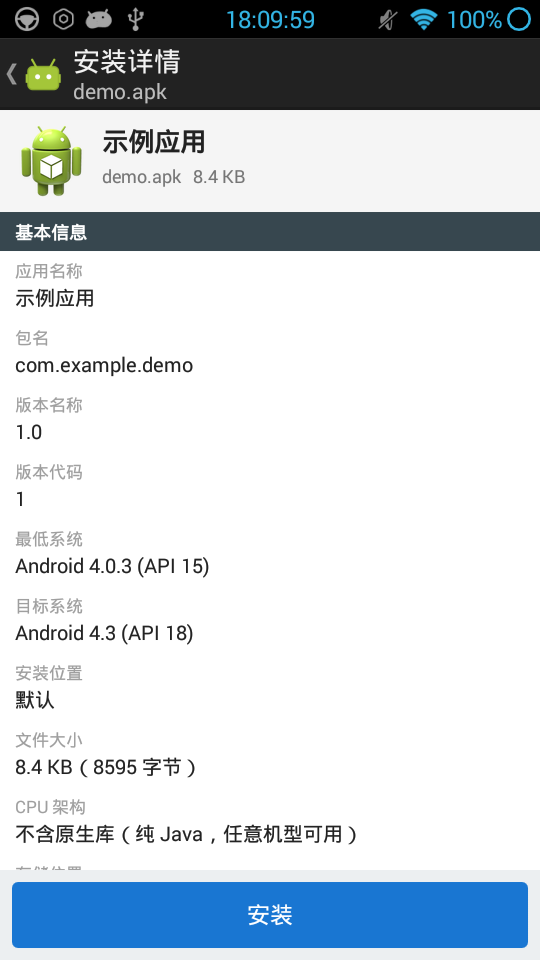
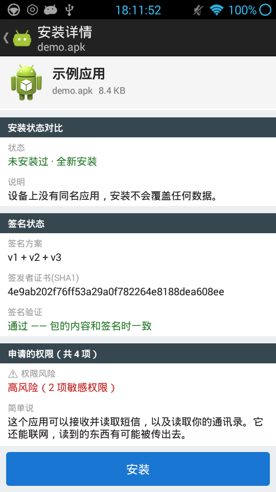
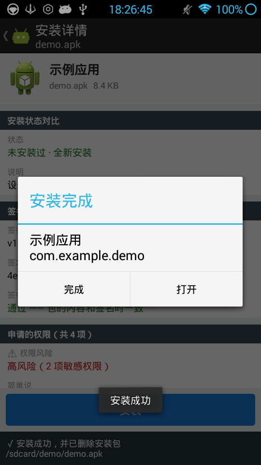

# RootInstaller — a root-based APK installer for Android 4.3

[](https://github.com/xiechara64-coder/RootInstaller/actions/workflows/build.yml)
[](https://github.com/xiechara64-coder/RootInstaller/actions/workflows/release.yml)
[](https://github.com/xiechara64-coder/RootInstaller/releases)
[](LICENSE)

**English** | [简体中文](README.md)

An APK installer built for **Android 4.3 (API 18)**. It solves two concrete problems:

1. **The stock installer tells you almost nothing.** It lists "required permissions" and
   nothing else — no package name, no version, no signature, no indication whether this is a
   fresh install or an upgrade, no size, and no explanation of what those permissions mean.
2. **Install directly with root**, skipping the system installer UI — and be callable as an
   installer by other apps.

> Target device: a **rooted** Android 4.3 (API 18) phone or tablet.
> The source compiles against API 15 (Android 4.0.3); development and verification were done on 4.3.

> [!WARNING]
> **This app requires root.** It runs `pm install` through `su`, which bypasses the system
> installer UI. Root means the device is no longer protected by the full system security
> boundary — evaluate the risk before using it. This software is provided "as is" under the
> MIT license, without warranty of any kind (see [LICENSE](LICENSE)).

## Screenshots

| Basic info | Signature comparison + permission risk | Install finished |
|---|---|---|
|  |  |  |

> The "demo app" in the screenshots is a test package built for these captures
> (`com.example.demo`), not a real application.

## Quick start

```powershell
# Windows: needs JDK 8+ and the Android SDK (auto-detected, can also be passed explicitly)
.\check-env.ps1     # verify the environment first
.\build.ps1         # build; the APK lands in the project root
adb install -r .\RootInstaller.apk
```

```bash
# Linux / macOS
./build.sh
adb install -r ./RootInstaller.apk
```

The toolchain is `aapt` + `javac` + `d8` + `zipalign` + `apksigner` — **no Gradle required**
(rationale in [Building](#building)). `build.ps1` generates a `debug.keystore` if one is missing.

---

## Contents

- [Screenshots](#screenshots)
- [Quick start](#quick-start)
- [What it shows that the stock installer doesn't](#what-it-shows-that-the-stock-installer-doesnt)
- [How it gets invoked](#how-it-gets-invoked)
- [How root installation works](#how-root-installation-works)
- [Building](#building)
- [Installing on the device](#installing-on-the-device)
- [Releasing (signed builds and CI)](#releasing-signed-builds-and-ci)
- [Code structure](#code-structure)
- [Known limitations](#known-limitations)
- [Troubleshooting](#troubleshooting)
- [Performance: how scanning got fast](#performance-how-scanning-got-fast)
- [Permission risk summary](#permission-risk-summary)
- [Signature detection](#signature-detection)
- [Settings](#settings)
- [Version compatibility](#version-compatibility)
- [Roadmap](#roadmap)
- [License](#license)

---

## What it shows that the stock installer doesn't

When you open an APK, this app parses and displays:

| Category | Content |
|---|---|
| **Basic info** | App name, package name, version name, version code, **minSdk (with Android version name)**, targetSdk, install location, exact file size in bytes, **CPU ABIs** |
| **Install-state comparison** | Installed version vs. this package, with an explicit verdict: **fresh install / upgrade / same-version overwrite / downgrade**, plus whether it will overwrite or needs an uninstall first |
| **Permission diff** | On upgrades: **⚠ N new permissions** (listed one by one in red) and which ones were removed (green). The stock installer has this too — apps love to add permissions in updates, and users rarely re-read the list when tapping "Update" |
| **Signature comparison** | Signer certificate SHA-1, **signature schemes (v1/v2/v3/v4)**, **integrity check**, and whether it matches the installed version — so you learn *before* installing that it will fail. All computed automatically when the details page opens; nothing is hidden behind a "compute" button |
| **System requirement changes** | On overwrite installs, flags whether **minSdk / targetSdk changed**. A raised minSdk means older devices can no longer install that update — and nothing warns you about it |
| **Signature status** | Four distinct states: unsigned / **v2-v3 only without v1** (a perfectly valid package that pre-7.0 systems refuse — this 4.3 device blocks it) / **v1 only with targetSdk ≥ 30** (installable here, rejected by Android 11+ with `NO_SIGNATURE`) / **v1 + v2/v3** (normal) |
| **Permissions** | Human-readable meaning of every permission plus protection level (dangerous / normal / signature); dangerous ones first, in red |
| **Components** | Activity / Service / Receiver / Provider counts, and the list of **exported components** — entry points other apps can call |
| **Checksums** | MD5 and SHA-1, computed on demand so first paint stays fast |
| **Actions** | One-tap root uninstall of the installed version, and an "allow downgrade" switch |

Side by side:

```
Stock installer                     RootInstaller
──────────────────────────────      ─────────────────────────────────────
App name                            App name + package name
(none)                              Version name + version code
(none)                              minSdk / targetSdk
(none)                              File size + CPU ABIs
(none)                              Fresh / upgrade / same / downgrade   ← the verdict, stated
(none)                              Signature schemes + signer + integrity  ← catch failures early
(none)                              Signature match vs installed version
Permission strings                  Meaning + protection level + risk order
(none)                              Component counts + exported entries
(none)                              MD5 / SHA-1
```

---

## How it gets invoked

Two kinds of entry points, three paths, covering the ways apps of the 4.3 era launch installers:

| # | Entry point | Notes |
|---|---|---|
| 1 | `Activity` + `ACTION_VIEW` + `mime = application/vnd.android.package-archive` | **The main path.** File managers, browsers, "Open" after a download — the app shows up in the chooser |
| 2 | `Activity` + `ACTION_INSTALL_PACKAGE` | Some apps (many vendor app stores) call the installer with this action directly |
| 3 | `BroadcastReceiver` + both actions above | A few apps broadcast instead of calling `startActivity`; only a registered receiver sees them |

All three funnel into `MainActivity` / `DetailsActivity`, which resolve the incoming
`file://` or `content://` URI to a real file path before opening the details page.

**About "set as default installer":** the app makes the system show a chooser when an APK is
opened. To make it the default, either tick "Use by default" in that chooser, or use
`Settings → Apps → menu → Reset app preferences` (on 4.3). Some ROMs have no such entry, in
which case you'll be asked every time.

---

## How root installation works

The core is one command:

```sh
su -c "pm install -r '/data/data/com.dsh.rootinstaller/cache/install/pkg.apk'"
```

Making that reliable took five fixes:

### 1. Why the APK is copied into the app's private directory

`pm install` runs as **shell/root**. Handing it `/sdcard/Download/xxx.apk` (or another app's
private file) runs into:

- directory permissions
- SELinux context (4.3 shipped SELinux; some ROMs are enforcing)
- spaces, CJK characters, quotes in the path

So the file is first copied to `/data/data/com.dsh.rootinstaller/cache/install/pkg.apk`, which
is guaranteed readable, and deleted after the install finishes.

### 2. Quote hell

The command is fed to `su -c sh` via **stdin** rather than `ProcessBuilder` argument arrays,
because different `su` implementations re-concatenate arguments and break paths containing
spaces. Feeding stdin means no second shell strips quotes for us — so paths are wrapped in
single quotes ourselves, with embedded quotes escaped as `'\''`. See `RootShell.quote()`.

### 3. Five `su` invocation styles

Different implementations (Superuser, SuperSU, stock) behave differently; the code tries, in order:

```
su -c sh      ← most common, preferred
su -c
su -s /system/sh
su 0 sh
su
```

The first one that works wins; there is no blind retry loop.

### 4. `pm install` flags are probed too

```
pm install -r  <apk>       ← overwrite
pm install -r -d <apk>     ← allow downgrade (when the switch is on)
pm install -r -t <apk>     ← allow testOnly packages (common for debug builds)
pm install <apk>           ← fallback for ancient ROMs that don't know -r
```

The next variant is only tried when the error looks like "unsupported flag". A genuine
failure (signature conflict, etc.) is not retried.

### 5. Errors translated into plain language

`pm` returns English constants; the app maps them and suggests a fix:

| `pm` error | Message shown |
|---|---|
| `INSTALL_FAILED_VERSION_DOWNGRADE` | This is a downgrade — enable "Allow downgrade" |
| `INSTALL_FAILED_UPDATE_INCOMPATIBLE` | Signature differs from the installed version; uninstall first |
| `INSTALL_FAILED_INSUFFICIENT_STORAGE` | Not enough storage |
| `INSTALL_FAILED_OLDER_SDK` | The app requires a newer Android version |
| `INSTALL_PARSE_FAILED_NO_CERTIFICATES` | Unsigned or corrupted signature |

The raw `pm` output is always shown as well, so you can judge for yourself.

---

## Building

### Prerequisites: Android SDK

You don't need a full Android Studio install — just the **SDK command-line tools**:

1. Download <https://developer.android.com/studio#command-line-tools-only>
2. Unpack, then:

```bash
sdkmanager "platforms;android-19" "build-tools;34.0.0"
```

> Why `android-19`? API 19 includes every public API of 4.3 without pulling in new API 21+
> classes, so compile-time checks stay accurate. `android-18` or `android-19` both work; the
> script picks whichever is present.

A **JDK** is required too (Java 8–17 all work; the script adapts the bytecode target).

### Option A: build directly (recommended)

**Run the environment check first** — it tells you what's missing:

```cmd
check-env.cmd
```

**Windows:**

```cmd
build.cmd
```

or double-click `build.cmd`. This is the **recommended entry point** because it bypasses
PowerShell's script-execution policy (see Troubleshooting) without changing any system setting.

PowerShell directly also works (execution policy permitting):

```powershell
.\build.ps1
.\build.ps1 -AndroidSdk "D:\android-sdk"          # explicit SDK path
.\build.ps1 -Platform 19 -BuildTools 34.0.0       # explicit platform / build-tools
```

**Linux / macOS:**

```bash
cd RootInstaller
chmod +x build.sh
./build.sh
# or
ANDROID_HOME=/path/to/sdk ./build.sh
```

The artifact is **`RootInstaller.apk`** in the project root, signed with the debug key so it
installs as-is.

The pipeline is the classic toolchain: `aapt` → `javac` → `d8` → package with `aapt` →
`zipalign` → `apksigner`.

> **Why not Gradle as the primary path?**
> Android Gradle Plugin 8.x requires `compileSdk >= 21`, while this project targets Android
> 4.3. `compileSdk 34` would compile (the source only uses 4.3 APIs), but that is one step
> further from the real 4.3 build environment. The classic pipeline is closer to the target
> platform and easier to debug when something breaks.

### Option B: Android Studio

Gradle config is included for convenience:

```bash
cp local.properties.example local.properties
# point sdk.dir at your SDK
./gradlew assembleDebug      # first run downloads AGP
```

Or just open the `RootInstaller` directory in Android Studio.

---

## Installing on the device

```bash
adb install -r RootInstaller.apk
```

If your host `adb` is much newer than the 4.3-era `adb` on the device, you may hit a protocol
error. In that case bypass adb:

```bash
adb push RootInstaller.apk /sdcard/RootInstaller.apk
```

then open it with any file manager on the phone (that step uses the stock installer — this app
can't install itself).

**The first launch pops a root prompt** — tap "Allow" and remember the choice.

---

## Releasing (signed builds and CI)

### Building a release yourself

```powershell
.\build.ps1 -Release -Keystore D:\keys\release.keystore -KsAlias release
```

The password is read from the `KS_PASS` / `KEY_PASS` environment variables (keeps it off the
command line; you can also pass `-KsPass`). `-Release` rebuilds the manifest with
`android:debuggable="false"` and enables v1 + v2 + v3 signatures, then prints the
`apksigner verify --verbose --print-certs` summary.

### CI

| Workflow | Trigger | What it does |
|---|---|---|
| `.github/workflows/build.yml` | push to `main`, PR, manual | Builds the debug APK, generates signature test samples, runs **11 offline test groups** (pure JVM, no device), uploads the APK artifact |
| `.github/workflows/release.yml` | push of a `v*` tag, manual | Builds with the release keystore, verifies v1+v2+v3 and `debuggable=false`, publishes a GitHub Release |

Release secrets (Settings → Secrets and variables → Actions):

| Secret | Value |
|---|---|
| `RELEASE_KEYSTORE_BASE64` | Base64 of the release keystore (one line) |
| `RELEASE_KEYSTORE_PASSWORD` | Keystore password |
| `RELEASE_KEY_ALIAS` | Key alias |
| `RELEASE_KEY_PASSWORD` | Key password (may be omitted if identical to the keystore password) |

Release notes are taken from `docs/release-notes/<tag>.md` when present, otherwise generated
from commit messages.

> **Keep the release keystore safe.** Lose it and you can never ship an update that overwrites
> the installed app — users would have to uninstall first.

---

## Code structure

```
RootInstaller/
├── check-env.cmd / check-env.ps1   environment check
├── build.cmd / build.ps1           Windows build (build.cmd is the preferred entry point)
├── build.sh                        Linux/macOS build
├── debug.keystore                  debug key (auto-generated; don't delete it)
├── app/src/main/
│   ├── AndroidManifest.xml         all three entry points
│   └── java/com/dsh/rootinstaller/
│       ├── MainActivity.java           list + external intents + ActionBar menu
│       ├── DetailsActivity.java        details page (info comparison + install)
│       ├── SettingsActivity.java       settings page
│       ├── InstallService.java         foreground service that performs the root install
│       ├── InstallReceiver.java        broadcast entry point
│       ├── ApkParser.java              APK parsing (including a binary AXML parser)
│       ├── ApkSignatures.java          v1/v2/v3 schemes + certificate + integrity (pure Java)
│       ├── SigCompat.java              signature scheme × OS version compatibility (pure Java)
│       ├── SdkChange.java              minSdk/targetSdk changes on upgrade (pure Java)
│       ├── ParseCache*.java            whole-APK parse result cache (codec is pure Java)
│       ├── CacheSweep.java             orphan-cache eviction rules (pure Java)
│       ├── RootShell.java              su invocation (fallbacks + quoting)
│       ├── Perms.java / PermSorter.java / PermDiff.java / PermAbilities.java
│       ├── ApkSorter.java              list sorting
│       └── ...
└── tests/
    ├── run-tests.ps1               run every offline test group (pure JVM, no device)
    ├── make-signed-samples.ps1     build sample APKs for every signature combination
    └── *Check.java                 11 test groups
```

Design trade-offs:

- **Zero third-party dependencies.** Dalvik on 4.3 is sensitive to method counts, and the app
  needs nothing beyond platform APIs.
- **No `androidx.*`.** The target platform is too old; those libraries only add problems.
- **`ListView`, not `ScrollView`, for the details page.** There can be dozens of permission
  rows; view recycling keeps it stable on old hardware.
- **Icons are generated by a script** (`tools/make-icon.ps1`) — no binaries in the repo, so
  everything is readable and diffable.
- **Signature-related classes deliberately avoid Android APIs** (`ApkSignatures`, `SigCompat`,
  `PermSorter`, `PermDiff`, `ApkSorter`, `ParseCache*`, `CacheSweep`). You can't single-step a
  signature parser on a 4.3 device, so the logic lives in pure Java and is verified on a PC
  against samples produced by `apksigner`. Adding an Android call in there makes
  `run-tests.ps1` fail immediately.

---

## Known limitations

Real, unavoidable limitations — not unfinished work:

1. **Root is required.** Without it the app can only show information. Tapping install tells
   you why; it never fails silently.
2. **The `su` prompt timing is out of our control.** If the superuser app is set to ask every
   time, every install needs a manual confirmation. That's the su app's behavior.
3. **Android 4.3 has no official "default installer" toggle.** The system always shows a
   chooser unless the ROM offers a default setting.
4. **The signature digest is the signer certificate's SHA-1**, the same value the system uses.
   It's taken from `META-INF/*.RSA|DSA|EC` (v1) or the APK Signing Block (v2/v3), both of which
   yield the raw X.509 encoding — byte-identical to what `PackageManager` returns, so a direct
   comparison works. This is verified in the test suite (copying an installed app's APK out and
   scanning it must report `match = true`).
   Note this is *signer identity*, not *whole-file integrity* — only v1 can check the latter.
5. **Parsing can be incomplete.** If an APK's `minSdkVersion` is newer than the system,
   `getPackageArchiveInfo()` may return null; the app then falls back to parsing the binary
   `AndroidManifest.xml`. The UI marks such results as **"fallback parse"**.
6. **`content://` URIs may not resolve to a path.** The app tries the `_data` column (usually
   works on 4.3) and otherwise asks you to pick the file manually.
7. **Only `.apk` files can be installed.** `pm install` requires the extension.
8. **No batch install.** One package at a time.
9. **"Delete the APK after a successful install" really deletes it.** Returning to its details
   page afterwards shows "this package is gone" and the install button is disabled. That's
   expected, not a bug.

---

## Troubleshooting

Short version; the [Chinese README](README.md#排错) has the full logs.

| Symptom | Cause / fix |
|---|---|
| `cannot be loaded because running scripts is disabled` | PowerShell execution policy. Use `build.cmd`, or `Set-ExecutionPolicy -Scope Process Bypass` for the current window only |
| Build fails with "insufficient memory" / `error=1455` | The JVM heap. `build.ps1` caps javac/d8 at 512 MB; close other heavy apps or raise the page file |
| `INSTALL_FAILED_UPDATE_INCOMPATIBLE` | Installed app was signed with a different key — uninstall first |
| `INSTALL_FAILED_VERSION_DOWNGRADE` | Enable "Allow downgrade" in the app |
| Install fails with `su: not found` / permission denied | Root isn't available or the su prompt was denied |
| Text renders as garbage on a Windows console | The terminal codepage; the scripts use UTF-8 with BOM. Run in Windows Terminal or `chcp 65001` |
| Two "three dots" in the ActionBar | A ROM that draws its own overflow icon; fixed by not adding the system menu button — see the Chinese README for the full story |

---

## Performance: how scanning got fast

Three rounds of measurement, each correcting a wrong assumption.

### Round 1 — remove a useless copy (7–18 s → ~6.3 s)

A "copy the APK to a private directory before parsing" fallback was suspected of helping
vendor ROMs. Instrumented measurements showed it helped **zero** of three samples and cost
80–210 ms per package. Deleted.

### Round 2 — per-package timing

`getPackageArchiveInfo` took only 93 ms, while loading label + icon took 2.3 s for a 41 MB APK.
Two `JarFile` opens per package (native ABI scan + AXML) were also removed: ABI scanning moved
to the details page, AXML is read once and reused.

### Round 3 — caching at two levels

**v1.0.1** cached icons on disk: only ~9% faster (33.8 s → 30.6 s, 52% hit rate).
Conclusion: icons are *not* the bottleneck.

**v1.0.2** cached the **whole parse result** (package name, version, label, API levels,
install location, permissions, component counts, signature schemes + certificate + integrity,
ABIs, **and the icon PNG**) in one file per APK:

| | Cold (first run / file changed) | Warm (cache hit) |
|---|---|---|
| Parse time | 33.6 s | **13.2 s** |
| Total time | 33.6 s | **14.1 s** |
| Cache hit | 0 | **154 / 154 (100%)** |

**≈2.4× faster.** Two lessons from building it:

- **Two caches will inevitably disagree.** The separate icon cache and the parse cache had
  different keys and cleanup rules, producing "the icon was written but is re-decoded every
  time" (warm scans stuck at 17 s). Merging the icon into the parse entry fixed the class of
  bug; the icon cache was deleted.
- **`getCacheDir()` is not durable here.** With `/data` nearly full, the system (`installd`)
  keeps wiping app cache directories, so the cache vanished between scans. It now lives in
  `getFilesDir()/cache/` (1.4 MB for 154 entries) with a size cap, LRU eviction and a manual
  clear button.

**v1.0.3** added orphan cleanup: cache entries whose APK disappeared are deleted only when
they are **both** absent from the current scan **and** older than 7 days — an unmounted SD card
makes every package on it "disappear", so immediate deletion would wipe the cache on every
card removal. If a scan sees no keys at all, nothing is deleted.

Remaining cost is `compareWithInstalled()` — one `PackageManager` query per package, which
cannot be cached safely (see Roadmap).

---

## Permission risk summary

Users don't understand `android.permission.READ_SMS`, and won't read forty rows. So the
permission section opens with a conclusion instead of a list:

> **Permission risk:** high (3 sensitive permissions)
> **In short:** this app can intercept and read your SMS (including bank codes), record audio
> silently, and track your location in real time. It can also access the network, so what it
> reads could leave the device.
> **Note:** the above is inferred from the permissions it requests; it does not prove the app
> has done any of it.

The one-sentence verdict, the "this is inference" note, and the capability list are ordered
deliberately: the note sits immediately *before* the specific accusations it qualifies, not at
the end (too late — the user has already concluded it's malware) and not at the start (it
defuses the warning).

The risk scale is one question: **can this permission reach user data, or control something
the user would notice?** That's why `INTERNET`, `ACCESS_NETWORK_STATE`, `VIBRATE`,
`WAKE_LOCK`, `FLASHLIGHT` are deliberately *not* marked dangerous even though the platform's
`protectionLevel` calls some of them dangerous. The single source of truth is
`Perms.resolveJudgment()`.

---

## Signature detection

Checking `META-INF` alone is wrong: a package signed only with v2/v3 has nothing there and
would be misreported as "unsigned". The app therefore:

1. reads v1 (`META-INF/*.RSA|DSA|EC`) when present,
2. parses the **APK Signing Block** for v2/v3 (and detects v4),
3. reports the signer certificate SHA-1, the scheme set, and an integrity verdict,
4. distinguishes four states (unsigned / v2-v3 only / v1 only with targetSdk ≥ 30 / v1+v2v3)
   because they fail in different ways on different Android versions.

v1 integrity is checked against `MANIFEST.MF`, including **line folding** — a folded
`Name:` value must be joined before comparing entry names, otherwise a perfectly valid vendor
APK gets accused of being tampered with. A regression test pins that behavior using a real
25 MB system APK.

---

## Settings

Reached from the ActionBar overflow (or the hardware menu key). Sections are ordered by when
the feature was added; "About" is always last.

| Option | Default | Notes |
|---|---|---|
| Delete the APK after a successful install | off | Irreversible, so off by default |
| Show more info on the details page | off | Adds checksums, component lists, exported entries |
| APK list sorting | by time | time / name / size / permission risk |
| Permission list sorting | by risk | risk / name / declaration order |
| Clear parse cache | — | Shows current usage (e.g. "1.4 MB / 154 entries") and clears it; automatic eviction runs anyway (600 entries / 8 MB, LRU, orphan sweep) |
| About | — | Icon, version, device and ROM info |

---

## Version compatibility

| Android | Status |
|---|---|
| 4.0.3–4.2 (API 15–17) | Compiles and should run; not tested on hardware |
| **4.3 (API 18)** | **Fully tested** on a Huawei C8816D |
| 4.4+ | Not a target; behavior unverified |

The code compiles to **bytecode level 8** and avoids Java 8 language features (lambdas,
streams) to stay friendlier to old toolchains.

---

## Roadmap

Ordered by value, with the reasons for *not* doing things recorded so the discussion doesn't
repeat.

1. **Cache the installed-version comparison too (the next big win).** Warm scans now take
   14.1 s, and about 13 s of that is `compareWithInstalled()`. To go faster this must be cached
   and invalidated via `PACKAGE_ADDED / PACKAGE_REMOVED / PACKAGE_REPLACED` broadcasts.
   The hard part is invalidation: miss one event and the UI shows "not installed" incorrectly —
   worse than being slow. Either do it properly or not at all; currently: not.
2. **Warn about "same signature, different package name".** Overwrite installation requires the
   *same package name* **and** the same signature, so same-signature/different-package packages
   can never overwrite each other. What's worth warning about is "the author renamed the
   package, you think you're upgrading but you end up with a second copy". One extra line on the
   details page; no grouping view.
3. **Batch install** — deferred. Real demand is "install a dozen packages after a reflash", but
   multi-select needs a new list mode, and on 4.3 devices one-at-a-time is the norm.
4. **Not doing: silent uninstall/freeze (`pm disable`).** Disabling a system or critical app on
   4.3 can break the launcher or prevent booting, recoverable only via a root shell. The benefit
   (power saving, hiding apps) is far smaller than the risk.

---

## License

[MIT](LICENSE) © 2026 the copyright holder (see `LICENSE`).

In short: use, modify, redistribute and sell freely, but keep the copyright and license
notice, and the software comes with no warranty.

Contributions: see [CONTRIBUTING.md](CONTRIBUTING.md) (build/test instructions and the
constraints learned the hard way). Issue templates are available in
[.github/ISSUE_TEMPLATE](.github/ISSUE_TEMPLATE).

### Third-party content

- This repository contains **only this project's own source** — no third-party libraries
  (platform APIs only).
- Real system APKs used for regression tests are **not** committed; they are vendor
  copyrighted works.
- The "demo app" in the screenshots is a test package built for the captures.
