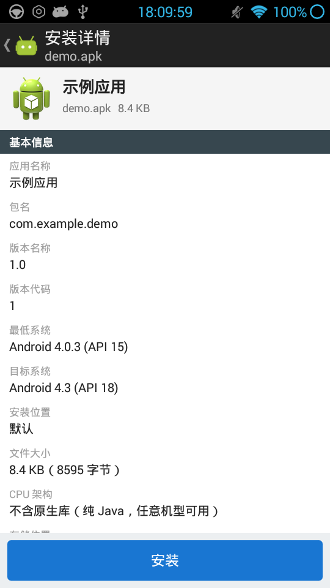
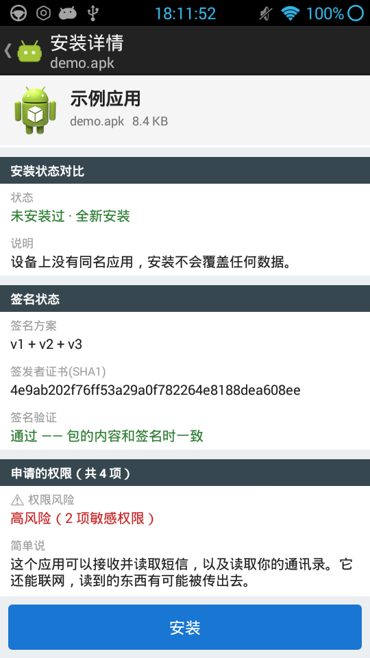
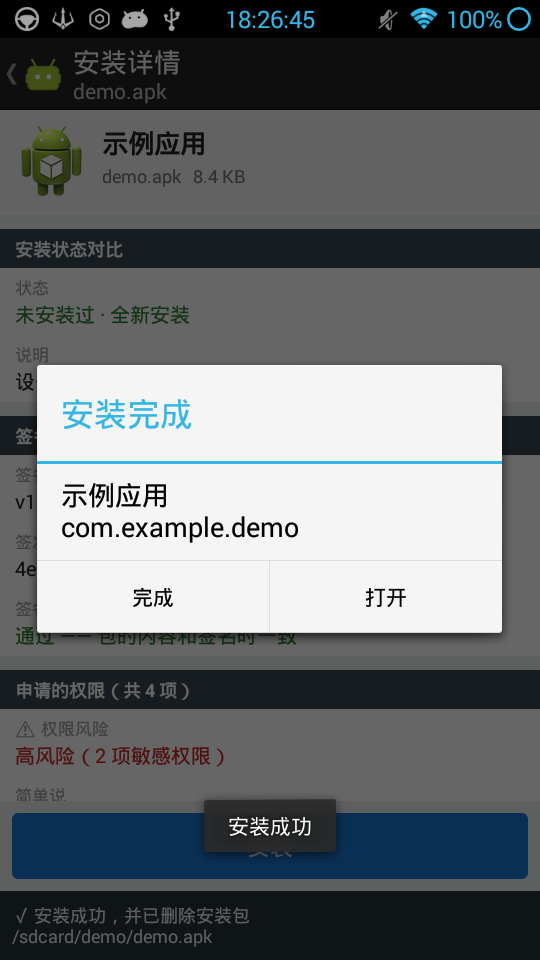

# RootInstaller — Android 4.3 的 root 包安装器

[](https://github.com/xiechara64-coder/RootInstaller/actions/workflows/build.yml)
[](https://github.com/xiechara64-coder/RootInstaller/actions/workflows/release.yml)
[](https://github.com/xiechara64-coder/RootInstaller/releases)
[](LICENSE)

一个面向 **Android 4.3 (API 18)** 的 APK 安装程序。解决两个具体问题：

1. **系统自带安装器信息太少** —— 它只列出「需要的权限」，不告诉你包名、版本、签名、
   是新装还是覆盖、体积多大、权限到底意味着什么。
2. **用 root 权限直接安装**，跳过系统安装界面，并且能被其它应用「调用」起来当安装器用。

> 目标设备：已 root 的 Android 4.3（API 18）手机/平板。
> 源码最低支持 API 15（Android 4.0.3），在 4.3 上开发验证。

> [!WARNING]
> **本应用需要 root。** 它通过 `su` 调用 `pm install` 来安装 APK，会跳过系统安装界面。
> root 本身意味着设备不再受系统安全边界的完整保护，请自行评估风险后再使用。
> 本软件按 MIT 许可证「按原样」提供，不附带任何担保（详见 [LICENSE](LICENSE)）。

## 截图

| 基本信息 | 签名对比 + 权限风险 | 安装完成 |
|---|---|---|
|  |  |  |

> 截图里的「示例应用」是为演示自建的测试包（`com.example.demo`），不是真实应用。

## 快速开始

```powershell
# Windows：需要 JDK 8+ 和 Android SDK（脚本会自动查找，也可用参数指定）
.\check-env.ps1     # 先确认环境齐全
.\build.ps1         # 构建，产物在 build\ 下
adb install -r .\RootInstaller.apk
```

```bash
# Linux / macOS
./build.sh
adb install -r ./RootInstaller.apk
```

构建链路是 `aapt` + `javac` + `d8` + `zipalign` + `apksigner`，**不依赖 Gradle**
（原因见「构建」一节）。缺少 `debug.keystore` 时 `build.ps1` 会自动生成一个。

---

## 目录

- [截图](#截图)
- [快速开始](#快速开始)
- [功能对照：比系统安装器多了什么](#功能对照比系统安装器多了什么)
- [它是怎么被「调用」的](#它是怎么被调用的)
- [root 安装是怎么实现的](#root-安装是怎么实现的)
- [构建](#构建)
- [安装到手机](#安装到手机)
- [发布（正式签名与 CI）](#发布正式签名与-ci)
- [代码结构](#代码结构)
- [已知限制（请务必看）](#已知限制请务必看)
- [排错](#排错)
- [崩溃排查](#崩溃排查)
- [真机实测修掉的问题（留个记录）](#真机实测修掉的问题留个记录)
- [关于重复 APK 的补充说明](#关于重复-apk-的补充说明)
- [AXML 整数属性的坑（versionCode 显示成 0 的教训）](#axml-整数属性的坑versioncode-显示成-0-的教训)
- [设置页](#设置页)
- [性能排查：扫描为什么从 3 秒变成 18 秒](#性能排查扫描为什么从-3-秒变成-18-秒)
- [关于「强制拉起系统安装器」的对策](#关于强制拉起系统安装器的对策)
- [权限风险汇总：把「一堆权限」翻译成人话](#权限风险汇总把一堆权限翻译成人话)
- [签名判断：为什么不能只看 META-INF](#签名判断为什么不能只看-meta-inf)
- [菜单入口：为什么会出现两个「三个点」，怎么修的](#菜单入口为什么会出现两个三个点怎么修的)
- [升级时「系统要求变了」为什么要单独指出](#升级时系统要求变了为什么要单独指出)
- [版本兼容范围（实测 + 静态审查）](#版本兼容范围实测--静态审查)
- [想继续改进的方向](#想继续改进的方向)
- [许可证](#许可证)

---

## 功能对照：比系统安装器多了什么

打开一个 APK，本应用会解析并展示：

| 分类 | 内容 |
|---|---|
| **基本信息** | 应用名称、包名、版本名称、版本代码、**最低支持 API（含 Android 版本名）**、目标 API、安装位置、文件大小（字节级）、**CPU 架构**（是否含原生库） |
| **安装状态对比** | 设备上已装版本 vs 本次包，明确判定：**全新安装 / 可升级 / 同版本覆盖 / 降级安装**，并给出会覆盖还是需要先卸载 |
| **权限差异** | 升级安装时对比权限：**⚠ 新增了 N 项权限**（红色逐条列出）+ 移除了哪些（绿色）。原生安装器也有这个提示 —— 应用常在更新时顺手多要权限，而用户点「更新」时基本不会重看权限列表 |
| **签名比对** | 签发者证书 SHA1 + **签名方案（v1/v2/v3/v4）** + **完整性核对** + 与已装版本的一致性判定，**提前告诉你会不会装不上**。<br>全部在打开详情页时**自动计算**，不需要手动触发 |
| **系统要求变化** | 覆盖安装时指出 **minSdk / targetSdk 有没有变**。特别是 **minSdk 被抬高**：这意味着更老的设备从此装不上这个新版本 —— 它不报错、不提示，用户点「更新」时根本不会想到 |
| **签名状态** | 分清四种形态：**未签名**（任何系统都装不上）／**只有 v2/v3、没有 v1**（包本身正常，但 Android 7.0 以前装不上，本机 4.3 会直接拦住）／**只有 v1 且 targetSdk ≥ 30**（本机能装，但 Android 11+ 直接拒装，报 `NO_SIGNATURE`）／**v1 + v2/v3**（正常） |
| **权限** | 每一条权限的**中文含义** + **保护级别**（危险/普通/签名级），危险的排在最前面并标红 |
| **组件** | Activity / Service / Receiver / Provider 数量，以及**「对外暴露」的组件清单**（其它应用可调用的入口，安全风险点） |
| **文件校验** | MD5、SHA1（按需计算，不拖慢首屏） |
| **其它操作** | 一键以 root 卸载已安装版本、允许降级安装的开关 |

系统安装器给的信息 vs 本应用：

```
系统安装器                          本应用
─────────────────────────────      ─────────────────────────────
应用名称                             应用名称 + 包名
（无）                               版本名称 + 版本代码
（无）                               最低 / 目标 API
（无）                               文件大小 + CPU 架构
（无）                               新装 / 升级 / 同版本 / 降级   ← 直接告诉你结果
（无）                               签名方案 + 签发者 + 完整性核对   ← 提前拦截装不上的情况
（无）                               签名一致性判定（仅比对，不预先算摘要）
权限字符串列表                       权限中文含义 + 保护级别 + 风险排序
（无）                               组件统计 + 对外暴露清单
（无）                               MD5 / SHA1 校验值
```

---

## 它是怎么被「调用」的

注册了**两种入口、三条路径**，覆盖 4.3 时代各种调用方式：

| # | 入口 | 说明 |
|---|---|---|
| 1 | `Activity` + `ACTION_VIEW` + `mime = application/vnd.android.package-archive` | **最主要的方式**。文件管理器、浏览器、下载完成后点「打开」，系统弹出选择器时本应用会出现 |
| 2 | `Activity` + `ACTION_INSTALL_PACKAGE` | 部分应用（含不少国产 ROM 自带的应用商店）用这个 action 直接调安装器 |
| 3 | `BroadcastReceiver` + 上述两个 action | 少数应用不发 `startActivity` 而是发广播，只有注册接收器才收得到 |

三个入口最终都汇总到 `MainActivity` / `DetailsActivity`，把 intent 里的
`file://` 或 `content://` 解析成真实文件路径，然后进入详情页。

**关于「设为默认安装器」：** 本应用会让系统在打开 APK 时弹出选择器。
如果你想让它成为默认，需要手动操作：
`设置 → 应用 → 菜单 → 重置应用偏好`（4.3 上的位置），
或者在弹出的选择器里勾选「默认使用此应用」。部分 ROM 没有这个入口，那就每次都会问。

---

## root 安装是怎么实现的

核心就一条命令：

```sh
su -c "pm install -r '/data/data/com.dsh.rootinstaller/cache/install/pkg.apk'"
```

但真正能跑起来需要处理几个坑，代码里都做了：

### 1. 为什么要把 APK 复制到私有目录

`pm install` 是以 **shell/root 身份**执行的。如果直接让它读
`/sdcard/Download/xxx.apk` 或者别人应用私有目录里的文件，很容易撞上：

- 目录权限不允许
- SELinux 上下文不对（4.3 时代已启用 SELinux，部分 ROM 是 enforcing）
- 路径里有空格、中文、单引号等特殊字符

所以先复制到 `/data/data/com.dsh.rootinstaller/cache/install/pkg.apk`，
这个路径**一定**是可读的。安装完自动删除。

### 2. 引号地狱

命令是通过 `stdin` 喂给 `su -c sh` 的（而不是 `ProcessBuilder` 的数组参数），
因为不同 su 实现会重新拼接参数，把带空格的路径拆坏。

但走 stdin 就没有第二层 shell 帮我们剥引号了，所以路径必须**自己**用单引号包好，
并且把路径里的单引号转义成 `'\''`。见 `RootShell.quote()`。

### 3. su 的写法有五种

不同 su 实现（Superuser / SuperSU / ROM 自带）行为不一样，代码依次尝试：

```
su -c sh      ← 最常见，首选
su -c
su -s /system/sh
su 0 sh
su
```

只要某一种能把 su 拉起来，就用它的结果，不再往下试。

### 4. pm install 的参数也要试探

```
pm install -r  <apk>       ← 覆盖安装
pm install -r -d <apk>     ← 允许降级（勾选后加 -d）
pm install -r -t <apk>     ← 允许 testOnly 包（debug 包常见）
pm install <apk>           ← 极老 ROM 不认识 -r 时的兜底
```

只有报错看起来是「参数不支持」时才换下一种；真正的安装失败（签名冲突之类）
不会盲目重试。

### 5. 报错翻译成人话

`pm` 的报错是英文常量，代码会翻译并给出建议，例如：

| pm 报错 | 提示 |
|---|---|
| `INSTALL_FAILED_VERSION_DOWNGRADE` | 这是降级安装，请勾选「允许降级」 |
| `INSTALL_FAILED_UPDATE_INCOMPATIBLE` | 签名与已装版本不一致，必须先卸载 |
| `INSTALL_FAILED_INSUFFICIENT_STORAGE` | 存储空间不足 |
| `INSTALL_FAILED_OLDER_SDK` | 应用要求的最低系统版本高于当前系统 |
| `INSTALL_PARSE_FAILED_NO_CERTIFICATES` | 未签名或签名损坏 |

同时会把 `pm` 的**原始输出**一并显示出来，方便你自己判断。

---

## 构建

### 前置：装好 Android SDK

不需要 Android Studio 完整装，只要 **SDK 命令行工具**：

1. 下载 <https://developer.android.com/studio#command-line-tools-only>
2. 解压，然后：

```bash
sdkmanager "platforms;android-19" "build-tools;34.0.0"
```

> 为什么是 `android-19`？因为 API 19 (4.4) 包含 4.3 的全部公开 API，
> 又不会引入 API 21+ 的新类，编译时能准确卡住「误用高版本 API」的问题。
> 只用 `android-18` 或 `android-19` 都可以，脚本会自动挑。

同时需要 **JDK**（Java 8 ～ 17 都行，脚本会自动适配字节码目标版本）。

### 方式 A：直接构建（推荐）

**先跑自检**，它会告诉你还差什么：

```cmd
check-env.cmd
```

**Windows：**

```cmd
build.cmd
```

或双击 `build.cmd`。这是**推荐入口**，因为它绕开了 PowerShell 的
「禁止运行脚本」限制（详见排错章节），不需要你改任何系统设置。

也可以直接用 PowerShell（需先放开执行策略）：

```powershell
.\build.ps1
.\build.ps1 -AndroidSdk "D:\android-sdk"          # 手动指定 SDK
.\build.ps1 -Platform 19 -BuildTools 34.0.0       # 指定平台/构建工具版本
```

**Linux / macOS：**

```bash
cd RootInstaller
chmod +x build.sh
./build.sh
# 或
ANDROID_HOME=/path/to/sdk ./build.sh
```

产物是项目根目录下的 **`RootInstaller.apk`**，已用调试密钥签名，可以直接安装。

这条链路用的是经典工具：`aapt` → `javac` → `d8` → `aapt` 打包 → `zipalign` → `apksigner`。

> **为什么不用 Gradle 作为主力？**
> Android Gradle Plugin 8.x 强制要求 `compileSdk >= 21`，而本应用的目标是 Android 4.3。
> 用 `compileSdk 34` 虽然能编过（源码只用到 4.3 的 API），但那条路离「4.3 的真实构建环境」
> 远了一层。经典链路更贴近目标平台，出问题也更好排查。

### 方式 B：Android Studio

项目里也带了 Gradle 配置：

```bash
cp local.properties.example local.properties
# 编辑 local.properties，把 sdk.dir 指向你的 SDK
./gradlew assembleDebug      # 首次需要联网下载 AGP
```

或者直接用 Android Studio 打开 `RootInstaller` 目录。

---

## 安装到手机

```bash
adb install -r RootInstaller.apk
```

如果你的电脑上 `adb` 版本比手机新（4.3 时代的 adb 比较老），可能会报协议错误。
那就绕过 adb，直接拷进去手动装：

```bash
adb push RootInstaller.apk /sdcard/RootInstaller.apk
```

然后在手机上用任意文件管理器点开它安装（这一步用的是系统安装器，
因为本应用还没装上去，没法自己装自己）。

装完后**第一次启动会弹 root 授权框**，务必点「允许」并勾选记住。

---

## 发布（正式签名与 CI）

### 自己出发布包

默认构建用项目根目录的 `debug.keystore` 签名（名字叫 debug，但只要文件还在，
它就是个稳定密钥，覆盖安装没问题）。**要对外发布**时用自己的密钥：

```powershell
$env:KS_PASS = "你的密钥库密码"        # 也可以改用 -KsPass 参数
.\build.ps1 -Release `
    -Keystore D:\keys\release.keystore `
    -KsAlias release `
    -OutApk RootInstaller-v1.0.0.apk
```

| 参数 | 作用 |
|---|---|
| `-Keystore` | 发布密钥库路径。不给就用 `debug.keystore` |
| `-KsAlias` | 密钥别名。不给会从 `keytool -list` 输出里自动识别 |
| `-KsPass` | 密钥库密码。不给读环境变量 `KS_PASS`（避免密码留在命令历史里） |
| `-KeyPass` | 私钥密码。不给读 `KEY_PASS`，再不给就用 `KsPass` |
| `-Release` | **把清单里的 `debuggable` 改成 false**，并启用 v1+v2+v3 签名 |

构建结束会打印实际生效的签名方案与证书指纹，用来核对"这个包到底是哪把钥匙签的"：

```
签名校验：
  Verified using v1 scheme (JAR signing): true
  Verified using v2 scheme (APK Signature Scheme v2): true
  Verified using v3 scheme (APK Signature Scheme v3): true
  Signer #1 certificate SHA-1: 432e2c02...
```

> **签名密钥一定要备份。** 换了密钥，老用户就装不上更新（系统只允许同签名覆盖安装），
> 只能卸载重装 —— 而卸载会丢掉该应用的数据。
> 发布密钥**绝不能**提交进仓库：`.gitignore` 已排除 `*.keystore` / `*.jks`。

### CI

仓库带两个 workflow：

| 文件 | 触发 | 做什么 |
|---|---|---|
| `.github/workflows/build.yml` | push 到 `main` / PR / 手动 | 构建 debug 包 + 跑那 11 组离线用例，产物作为 artifact |
| `.github/workflows/release.yml` | 打 `v*` tag / 手动 | 用发布密钥签 **Release 包**，校验 v1+v2+v3 与 `debuggable=false`，挂到 GitHub Release |

`build.yml` **不需要任何密钥**（`build.ps1` 会自动生成 debug.keystore）。

`release.yml` 需要先在仓库的
`Settings → Secrets and variables → Actions` 里配四个 secret：

| Secret | 内容 |
|---|---|
| `RELEASE_KEYSTORE_BASE64` | 发布密钥库的 base64（单行） |
| `RELEASE_KEYSTORE_PASSWORD` | 密钥库密码 |
| `RELEASE_KEY_ALIAS` | 密钥别名 |
| `RELEASE_KEY_PASSWORD` | 私钥密码（与库密码相同可留空） |

生成 base64：

```powershell
[Convert]::ToBase64String([IO.File]::ReadAllBytes("D:\keys\release.keystore")) |
  Set-Clipboard
```

然后发布：

```bash
git tag v1.0.0
git push origin v1.0.0
```

workflow 会把密钥解码到 `$RUNNER_TEMP`（作业结束即销毁，不落工作区），
构建、校验、发布，最后把 APK 挂到 Release 页。

---

## 代码结构

```
RootInstaller/
├── check-env.cmd                  Windows 环境自检入口
├── check-env.ps1                  检查 JDK / SDK / adb 是否齐备
├── build.cmd                      Windows 首选入口（绕开执行策略限制，纯 ASCII）
├── build.ps1                      Windows 构建脚本（UTF-8 带 BOM）
├── debug.keystore                 调试签名密钥（首次构建自动生成；**别删**，删了密钥就变）
├── build.sh                       Linux/macOS 一键构建
├── build.gradle / settings.gradle Gradle（Android Studio）备用路径
├── local.properties.example       Android Studio 用的 SDK 路径示例
├── .android-sdk/                  （可选）把 SDK 放这里，脚本自动发现
├── app/
│   ├── build.gradle
│   ├── proguard-rules.pro
│   └── src/main/
│       ├── AndroidManifest.xml    三种调用入口都注册在这里
│       ├── java/com/dsh/rootinstaller/
│       │   ├── App.java                Application 入口：最早时机装崩溃记录器
│       │   ├── MainActivity.java       主界面 + 外部 intent 入口 + ActionBar 菜单
│       │   ├── DetailsActivity.java    详情页（核心：信息对比 + 安装）
│       │   ├── SettingsActivity.java   设置页（安装行为 / 显示 / 关于）
│       │   ├── Settings.java           设置项的读写（SharedPreferences）
│       │   ├── BusyDialog.java         扫描时的旋转加载弹窗
│       │   ├── FilePickerActivity.java 手动选安装包
│       │   ├── InstallService.java     前台 Service，真正执行 root 安装
│       │   ├── InstallReceiver.java    广播形式的调用入口
│       │   ├── CrashReporter.java      崩溃记录 + 下次启动弹窗 + 一键复制
│       │   ├── CrashTestActivity.java  崩溃自测（不导出，只能 root 调起）
│       │   ├── ApkParser.java          APK 解析（含二进制 AXML 解析器）
│       │   ├── ApkSignatures.java      签名判断：v1/v2/v3 方案 + 证书 + 完整性（纯 Java，可离线测）
│       │   ├── ApiNames.java           API 等级 ↔ Android 版本名（零依赖，三处共用一张表）
│       │   ├── SigCompat.java          签名方案 × 系统版本 的兼容性判定（纯 Java，可离线测）
│       │   ├── SdkChange.java          升级时 minSdk/targetSdk 有没有变（纯 Java，可离线测）
│       │   ├── ApkCard.java            解析结果的数据模型
│       │   ├── InfoAdapter.java        详情页列表适配器
│       │   ├── ApkListAdapter.java     主界面列表适配器（含异步图标加载）
│       │   ├── FileListAdapter.java    文件选择器适配器
│       │   ├── RootShell.java          su 调用（多写法回退 + 引号处理）
│       │   ├── Perms.java              权限中文含义表 + 保护级别
│       │   ├── PermSorter.java         权限列表排序（按风险／字母／声明顺序）
│       │   ├── ApkSorter.java          安装包列表排序（时间／名称／体积／风险）
│       │   ├── PermDiff.java           权限集合差异（升级安装时的新增/移除）
│       │   ├── Paths.java              存储路径工具
│       │   ├── IntentPaths.java        intent → 文件路径解析
│       │   └── Log.java                日志封装
│       └── res/
│           ├── layout/                 8 个布局（详情页用 ListView 拍平行，省内存）
│           ├── drawable/               图标由 tools/make-icon.ps1 生成（机器人 + 占位图 + 竖点）
│           └── values/                 字符串 / 主题
├── tools/
│   └── make-icon.ps1              用脚本画图标（仓库里不存二进制，可读可重跑）
└── tests/
    ├── run-tests.ps1              一键跑全部离线用例（纯 JVM，不需要设备）
    ├── make-signed-samples.ps1    用 apksigner 造各种签名组合的样本
    ├── ApkSignaturesCheck.java    签名判断的离线验证（含「v2-only 不能误报未签名」）
    ├── SigCompatCheck.java        签名方案 × 系统版本 兼容性判定（两条反向硬规则）
    ├── SdkChangeCheck.java        升级时 minSdk/targetSdk 变化方向（8 组断言）
    ├── make-minsdk-samples.ps1    造同包名、minSdk 不同的样本（验证「要求提高」提示）
    ├── ApkSignaturesHuaweiCheck.java 折行清单回归（用真实系统应用钉住，防误报「被改动过」）
    ├── fixtures/                  （可选）放真实系统应用样本，不进仓库
    ├── PermSortCheck.java         权限列表排序的离线验证
    ├── PermAbilitiesCheck.java    权限风险汇总的离线验证（15 组断言）
    ├── PermRiskCheck.java         危险权限判定的离线验证（「加重」「减轻」两个方向都钉住）
    ├── PermDiffCheck.java         权限差异对比的离线验证（11 组断言）
    └── ApkSorterCheck.java        安装包列表排序的离线验证
```

几个设计取舍：

- **不引入任何第三方依赖**。4.3 的 Dalvik 对依赖和方法数比较敏感，
  而且这个应用完全用系统原生 API 就能实现，没必要引 support library。
- **不引入 `androidx.*`**。目标平台太老，引进来只会增加问题。
- **详情页用 `ListView` 而不是 `ScrollView`**。信息行数多（权限可能几十条），
  ListView 能复用视图、能整体滚动，在 4.3 的老机器上更稳。
- **图标全用 XML shape**，仓库里没有二进制文件，所有代码都可直接阅读和 diff。
- **签名判断相关的类刻意不引用 Android API**（`ApkSignatures`、`SigCompat`、`PermSorter`、
  `PermDiff`、`ApkSorter`）。这不是巧合而是约束：真机上没法单步调试签名格式的解析，
  做成纯 Java 就能在 PC 上用 `apksigner` 造的样本把每条边界跑穿。
  一旦有人在里面加了 Android 调用，`run-tests.ps1` 会立刻编不过。

---

## 已知限制（请务必看）

这些是真实的、无法绕过的限制，不是没做完：

1. **必须有 root。** 没 root 的话本应用只能「看信息」，不能装。
   没 root 时点安装会明确提示你，不会静默失败。

2. **`su` 的授权弹窗时机不受控制。** 首次调用 `su` 时，
   授权应用（Superuser / SuperSU）会弹窗。如果用户的手机设置了
   每次都要询问，那么**每次安装都需要手动点确认一次**。这是授权应用的行为，应用层改不了。

3. **4.3 没有「默认安装器」的官方开关。**
   系统打开 APK 时一定弹出选择器（除非用户在 ROM 里设置了默认）。
   可以用 `pm set-installer` 之类的命令配合，但那需要额外权限且各 ROM 行为不同，
   本应用没有做这件事。

4. **签名摘要取的是「签名者证书的 SHA1」，和系统同口径。**
   证书来源分两条路，哪条先拿到用哪条：
   - **v1（Jar 签名）**：`META-INF/` 下的 `*.RSA|DSA|EC`。文件名由签名者决定
     （`CERT.RSA` / 别的名字都可能），且**没有公开 API 能直接读**，得自己解析。
   - **v2/v3**：解析 APK Signing Block 的 signed-data。

   两条路取到的都是 X.509 证书的**原始编码**，和 `PackageManager` 给出的
   `Signature.toByteArray()` 是同一份字节 —— 所以「本包签名」和「已装版本签名」
   可以**直接比对**，不需要换算。

   实测验证过这一点：把已安装应用的 APK 拷出来当「待装包」扫，判定为
   `一致=true`（证明这个值与系统口径可比）。这是最容易悄悄回归的地方，
   所以它同时是 `tests/` 里的一条硬判据。

   注意这只是**签名者身份**（用来判断"是不是同一把密钥"），不等于
   「整包完整性校验通过」—— 后者只有 v1 能做（见下文「完整性核对」）。

5. **APK 解析失败时信息会不完整。**
   如果 APK 的 `minSdkVersion` 高于本机系统，`getPackageArchiveInfo()` 可能返回 null。
   这时会退化到「自己解析二进制 AndroidManifest.xml」，能挖出包名和版本号，
   UI 会明确标注 **「兜底解析」**，请对这类信息打个折扣。仍然可以尝试安装。

6. **`content://` 类型的调用可能拿不到路径。**
   有些应用用 `FileProvider` 传 `content://` URI。本应用会尝试查 `_data` 列
   （这在 4.3 上通常有效），拿不到就明确提示用户手动选择文件，不会静默失败。

7. **`.apk` 之外的文件不能安装。** 这是 Android 本身的限制
   （`pm install` 要求文件名以 `.apk` 结尾，且内容是 APK）。
   如果你拿到的是被改名的包，先改回 `.apk`。

8. **没有做批量安装。** 一次只能处理一个包。

9. **勾了「安装成功后删除安装包」之后，这个包就真的没了。**
   装完再打开它的详情页（比如从返回栈回到那一页），会看到
   **「这个安装包已经不在了」**，安装按钮变成「安装包已被删除」。

   这是**预期行为，不是出错** —— 界面上也这么写。把它单列出来是因为它容易被
   误当成故障：以前这个场景会走进「无法解析这个安装包」的分支，还配上
   「文件损坏 / 不是标准 APK / ROM 拒绝」三条原因，一条都不对，用户根本无从判断。

   根因是个执行顺序问题：`load()` 是**异步**的（后台线程解析），而删除紧接着
   同步执行，等后台线程真正读文件时它已经被删了。现在是**先删、再决定要不要
   重新解析**。顺带在「可能的原因」里补了第 4 条「文件刚被删除或被移走」。

---

## 排错

### 报「在此系统上禁止运行脚本」（UnauthorizedAccess）

Windows 默认执行策略是 `Restricted`，禁止运行任何 `.ps1`。三个办法：

**办法 1：用 `.cmd` 入口（推荐，不改系统设置）**

```cmd
build.cmd
```

或直接双击 `build.cmd`。`.cmd` 批处理**不受执行策略限制**，
它内部以 `-ExecutionPolicy Bypass` 调用 PowerShell ——
该参数只影响那一个子进程，**不会修改你系统的任何设置**。

**办法 2：单次绕过**

```powershell
powershell -ExecutionPolicy Bypass -File .\build.ps1
```

**办法 3：永久放开（改的是你的用户级设置）**

```powershell
Set-ExecutionPolicy -Scope CurrentUser -ExecutionPolicy RemoteSigned
```

含义是：本地写的脚本可以跑，从网上下载的必须签名。
比 `Unrestricted` 安全，是日常开发最常用的设置。撤销：

```powershell
Set-ExecutionPolicy -Scope CurrentUser -ExecutionPolicy Undefined
```

---

### 报「找不到 keytool」

`keytool` 随 JDK 一起安装，但**不在 Oracle 的 `javapath` 垫片目录里**
（那目录下只有 `java.exe`、`javac.exe`、`javaw.exe`、`jshell.exe`）。
所以只装 JRE、或者只靠 PATH，就会找不到它。

构建脚本已经会自动去这些位置翻：

- `PATH`
- `%JAVA_HOME%\bin`
- `C:\Program Files\Java\*`（含子目录，如 `jdk-26.0.2`）
- `C:\Program Files\Eclipse Adoptium\*`、`Zulu`、`Amazon Corretto`、
  `Microsoft\jdk`、Android Studio 自带的 `jbr` / `jre`

如果 JDK 装在别的地方：

```powershell
$env:JAVA_HOME = "D:\你的jdk路径"
.\build.ps1
```

---

### 脚本里的中文变乱码，报出奇怪的语法错误

如果你用会丢 BOM 的编辑器改过 `build.ps1` 的注释，可能踩到这个坑：

> **Windows PowerShell 5.1 在没有 BOM 时，会按系统 ANSI 代码页（中文系统是 GBK）读 `.ps1`。**

于是 UTF-8 的中文注释被解成乱码；某个中文字符的字节如果恰好解出引号结构，
就会把整个脚本的语法搞崩，报出**看起来完全不相关**的错误，例如：

```
Unexpected token 'sources.txt"' in expression or statement.
Missing closing '}' in statement block or type definition.
```

还有一种更隐蔽的症状：**报错的行号和文件实际内容对不上**
（例如提示「第 123 行的 $body 为 null」，而第 123 行其实是个赋值语句）。
这是因为乱码吃掉了相邻字符，解析出的行偏移已经全乱了 ——
遇到这种「行号对不上」的情况，八成就是 BOM 丢了。

**修法**：把文件另存为「UTF-8 带 BOM」。或命令行补 BOM：

```powershell
$p = ".\build.ps1"
$t = [IO.File]::ReadAllText($p, [Text.Encoding]::UTF8)
[IO.File]::WriteAllText($p, $t, (New-Object Text.UTF8Encoding($true)))
```

仓库里的 `*.ps1` 都已带 BOM。可以用下面这段一次性体检：

```powershell
Get-ChildItem -Recurse -Include *.ps1 | ForEach-Object {
    $b = [IO.File]::ReadAllBytes($_.FullName)
    $ok = $b.Length -ge 3 -and $b[0] -eq 0xEF -and $b[1] -eq 0xBB -and $b[2] -eq 0xBF
    "{0,-22} {1}" -f $_.Name, $(if ($ok) { "BOM ✓" } else { "BOM 缺失 ✗" })
}
```

`build.cmd` / `check-env.cmd` 则刻意保持**纯 ASCII**，因为 cmd.exe 用 OEM 代码页读批处理文件。

> **注意：这个坑本项目管理里踩过两次。** 第一次是 `build.ps1`（构建直接失败），
> 第二次是 `tools/make-icon.ps1` —— 用 `[IO.File]::WriteAllText` 写入时忘了
> 指定 `UTF8Encoding($true)`，结果脚本仍然「能跑」，只是**部分图标生成静默失败**
> （画出来的 PNG 只有 0.16 KB、全是透明像素），很不容易发现。
> 所以每次用程序改写 `.ps1` 之后，都要回头确认 BOM 还在。

---

### 报「没有找到 Android SDK」

**这是唯一需要你手动准备的东西。**

**A. 装 Android Studio**（最省事，还附带 `adb`）

1. <https://developer.android.com/studio>
2. 装完在 **SDK Manager** 里勾上：
   - `SDK Platforms` → **Android 4.4 (API 19)**
   - `SDK Tools` → **Android SDK Build-Tools**
3. 脚本会自动在 `%LOCALAPPDATA%\Android\Sdk` 找到它

**B. 只装命令行工具**（几百 MB）

1. <https://developer.android.com/studio#command-line-tools-only>
2. 解压到比如 `D:\android-sdk`
3. 装两个包：

```cmd
D:\android-sdk\cmdline-tools\latest\bin\sdkmanager.bat "platforms;android-19" "build-tools;34.0.0"
```

4. 告诉脚本 SDK 在哪：

```powershell
.\build.ps1 -AndroidSdk "D:\android-sdk"
```

**偷懒做法**：把 SDK 放到项目的 `.android-sdk` 目录下，脚本会自动发现，
不用配环境变量也不用带参数。

---

### 没有网络怎么办

`dl.google.com` 和 Maven 连不上时 `sdkmanager` 会直接失败。可以：

1. **换网络**：SDK 下载源在国内经常不通，换网络或挂代理通常能解决。
2. **从别的机器拷**：SDK 目录是绿色的（不写注册表）。在能下载的机器上装好后
   整个目录拷过来即可，只需要：
   ```
   <SDK>/platforms/android-19/android.jar
   <SDK>/build-tools/<版本>/   （含 aapt.exe、d8.bat、zipalign.exe、apksigner.bat）
   ```
   放到本项目 `.android-sdk/` 下，保持目录结构一致。
3. **好消息**：本项目刻意不引入任何第三方依赖（连 support library 都没用），
   所以除了 SDK 本身，不需要再从网上拉任何东西 ——
   **只要 SDK 到位，构建全程离线可完成**。

---

### 构建时报 `无效文件名: ?D:\...\Xxx.java`

那个 `?` 就是罪魁祸首。这是 **javac 的 `@argfile` 带了 UTF-8 BOM** 导致的：

`Set-Content -Encoding UTF8` 在 Windows PowerShell 5.1 下会写入 BOM，
而 **javac 不会跳过 BOM**，它把 BOM 的三个字节当成了文件名的第一个字符，
于是 `D:\...` 变成了 `?D:\...`，报「无效文件名」。

**规则：javac 的 argfile 必须是 UTF-8 无 BOM。** 构建脚本用的是：

```powershell
$utf8NoBom = New-Object System.Text.UTF8Encoding($false)   # $false = 不写 BOM
[System.IO.File]::WriteAllLines($argFile, [string[]]$sourceFiles, $utf8NoBom)
```

注意这个坑和上一节「脚本本身要带 BOM」**方向正好相反**：
`.ps1` 要带 BOM，javac 的 argfile 不能带 BOM。

---

### 构建失败，但报错只是一句 `Note: ... uses a deprecated API`

这是 PowerShell 的一个陷阱，**不是编译失败**。

Windows PowerShell 会把外部程序写到 **stderr** 的每一行包成 `ErrorRecord`；
而脚本开头设置了 `$ErrorActionPreference = "Stop"`，于是一句无害的
`javac` 提示就会直接把构建中断掉 —— 命令明明成功了，脚本却报失败。

构建脚本的应对方式是把外部工具的输出**重定向到文件再读回来**，
让它完全不经过 PowerShell 的错误流：

```powershell
& cmd.exe /c "`"$Exe`" $quotedArgs > `"$log`" 2>&1"
```

这样输出一行不丢，退出码也准确。

---

### 报 `keytool` 用法/参数错误，`-dname` 只收到一半

含空格或逗号的参数被错误拆分了。典型症状是
`-dname "CN=Android Debug,O=Android,C=US"` 传进去只剩 `Debug,O=Android,C=US`。

原因是把参数数组简单 `-join ' '` 拼成命令行时，没有给每个参数加引号。
`Invoke-Tool` 会为每个参数单独加双引号（并把参数里原有的 `"` 转义成 `\"`），
所以正常不会遇到。

---

### 点安装之后没有任何反应

打开 logcat 看日志，所有关键步骤都打了日志：

```bash
adb logcat -s RootInstaller
```

常见原因：
- **授权弹窗被忽略了**（可能被系统的「悬浮窗权限」挡住）。去授权管理应用里
  手动把本应用设为「允许」。
- **su 不可用**。菜单 →「检测 root 权限」会明确告诉你结果和 `id` 命令的输出。

### 安装提示「签名不一致」

包名相同但签名不同的两个包无法互相覆盖。只能：

1. 先在系统设置里**卸载旧版本**（会丢失该应用的数据），再装新的；或者
2. 找到与原版**同一签名**的包。

本应用在详情页会**提前**告诉你这一点，不用等到安装失败。

### 自己构建时反复报 `INSTALL_FAILED_UPDATE_INCOMPATIBLE`

如果这个错误出现在**你自己构建并覆盖安装本应用**的过程中（而不是装别的 APK），
那多半是构建脚本的问题，不是包的签名真有问题：

调试密钥库如果放在 `build\` 里，而你又清过 `build\`（或用了 `tests\run-tests.ps1`），
密钥库会被一起删掉并重新生成 —— **每次构建的密钥都不同**，系统自然拒绝覆盖。

现在密钥库固定在项目根目录 `debug.keystore`。确认方法：

```powershell
# 清掉产物再连构两次，两次证书 SHA-1 必须相同
$bt = "<SDK>\build-tools\36.0.0\apksigner.bat"
Remove-Item build -Recurse -Force
.\build.ps1 ; & $bt verify --print-certs RootInstaller.apk | Select-String "SHA-1 digest"
Remove-Item build -Recurse -Force
.\build.ps1 ; & $bt verify --print-certs RootInstaller.apk | Select-String "SHA-1 digest"
```

注意：**不要拿 APK 的 SHA256 来判断**，那个每次都不一样（zip 里带构建时间戳）。
要看的是**证书指纹**。

如果换了密钥（比如从旧版本升上来），卸载一次即可，之后就能正常覆盖安装了。

### 报 `INSTALL_FAILED_VERSION_DOWNGRADE`

新包版本号低于已装版本。勾选详情页底部的 **「允许降级安装」** 再点安装。

### 报 `INSTALL_FAILED_OLDER_SDK`

这个应用要求的最低系统版本高于你的 4.3。装不了，除非找到适配低版本的包。

### 报 `INSTALL_FAILED_INSUFFICIENT_STORAGE`

存储空间不足。注意 Android 的应用是装到 **`/data` 分区**的，
SD 卡剩余空间再多也没用。清理 `/data` 空间。

### 构建时报找不到 android.jar 或 build-tools

```bash
sdkmanager --list                      # 看装了哪些
sdkmanager "platforms;android-19" "build-tools;34.0.0"
```

或者用参数手动指定：`.\build.ps1 -Platform 19 -BuildTools 34.0.0`

### 构建时报 `无效的标记: -source 7`

新版本 JDK（21+）移除了对 `-source 7` 的支持。构建脚本已经会自动判断并降到 `8`，
如果你手动改过脚本，注意这一点。

### 在 DSH 的受限沙箱里构建：报 `Access is denied`

**先说结论：这不是脚本或 JDK 的问题，是沙箱的一条既有边界。**

现象：在 DSH 会话里跑 `build.ps1` / `build.cmd`，得到

```
Program 'java.exe' failed to run: Access is denied
```

或某个工具（`javac` / `d8` / `aapt`）报同样的错，看起来像"程序起不来"。

这是 Windows ACL 受限沙箱的一条既有边界：
受限令牌的「限制 SID 列表」里**没有任何 SID 被授予管道客户端所需的写权限**，
所以**只要命令的输出被捕获/重定向，整条命令就会以 `Access is denied` 失败**。

而 `build.ps1` **重度依赖捕获**——它把每个工具的输出重定向到日志文件再读回来
（为了绕开 PowerShell 把 stderr 包成 `ErrorRecord` 的老问题，见「构建」一节）。
在这条边界下，那套做法必然全灭。

**怎么分辨是不是这个原因**：做个 A/B 对照，唯一变量是「是否捕获」：

```powershell
& cmd.exe /c "echo A"                        # ✅ 通常成功，输出直接可见
$out = & cmd.exe /c "echo B"                 # ⚠️ 不报错，但 $out 是空的
$out2 = & cmd.exe /c "echo C" | Out-String   # ❌ Access is denied
```

**绕过办法**——不要在 PowerShell 侧捕获，让输出直接继承到控制台：

```powershell
# 可以这样（不捕获）
& cmd.exe /c "D:\DSH\RootInstaller\build.cmd"

# 不要这样（捕获 / 管道 / 2>&1 都会触发）
$log = & cmd.exe /c "...\build.cmd" 2>&1
```

或者把会话升到 `danger-full-access`（该模式不套受限令牌），构建即可正常跑完——
本项目最后一次完整构建与全部用例就是在该模式下完成的。

> 补充：这条限制在沙箱内部**不是稳定单一的**。实测同一操作还会间歇性地
> 以 `0xC0000142`（`STATUS_DLL_INIT_FAILED`，进程**已创建**才失败）出现，
> 与 `Access is denied`（进程**未创建**）处于不同阶段。
> 已整理成报告反馈上游；若该问题修好，本节所述限制应随之消失。

---

## 崩溃排查

这个应用在真机（华为 C8816D / Android 4.3）上实测过，期间修掉了几个只有在真实
设备上才会暴露的问题。为了让后续排查不再靠猜，内置了一套崩溃记录机制。

### 自动记录 + 下次启动弹窗

1. 应用崩溃时，`CrashReporter` 把**完整堆栈 + 设备信息 + 崩溃前正在做什么**
   写进私有文件 `files/crash/last-crash.txt`；
2. 下次打开应用会**自动弹窗**展示这份报告；
3. 弹窗上有 **「复制崩溃信息」** 按钮，点一下整份日志进剪贴板，粘贴发出去即可。

报告包含：时间、线程、应用版本、设备型号、ROM 版本、CPU 架构、
崩溃前的运行状态（例如「[InstallService] 步骤3: 执行 pm install」）、
异常类型、完整堆栈，以及 `cause` 链（真正的原因常藏在深层 cause 里）。

### 用 adb 取日志（信息最全）

```bash
# 实时看应用日志（所有关键步骤都打了日志）
adb logcat -s RootInstaller:*

# 崩溃后取出记录文件（需要 root）
adb shell su -c "cat /data/data/com.dsh.rootinstaller/files/crash/last-crash.txt"

# 或者拷到电脑上
adb shell su -c "cp /data/data/com.dsh.rootinstaller/files/crash/last-crash.txt /sdcard/crash.txt"
adb pull /sdcard/crash.txt
```

> `adb shell run-as` 在部分 ROM（实测华为 C8816D）上不可用，
> 所以上面用的是 root 方式。`android:debuggable="true"` 仍然保留着，
> 在没有这个限制的设备上 `run-as` 也能用。

### 有意保留的诊断日志

打开任何安装包详情页，日志里都会有这样几行：

```
I/RootInstaller: 详情页渲染完成 共 38 行 | 已装=true 权限差异已知=true 新增=0 移除=0 风险等级=2
I/RootInstaller: 签名 com.example.sigcheck | 状态=有签名 | 方案=v1 | 证书=有 | 完整性=通过 | 已装=true | 一致=true
I/RootInstaller: 系统要求变化 com.example.sigcheck | 已装 minSdk=18 targetSdk=18 | 本次 minSdk=23 targetSdk=18 | minSdk方向=提高 | 是否展示=true
I/RootInstaller: 菜单入口[主界面] 实体菜单键=true，系统溢出=false，自绘入口=显示
```

这**不是调试残留，是有意保留的**。原因：目标 ROM 上 `input swipe` 注入不可用，
而 `uiautomator dump` 又只包含屏幕上可见的行 —— 想知道「详情页到底渲染了多少行」、
「签名判成了什么」、「系统要求变化有没有识别出来」，只能靠这几行日志。

排查布局错乱、区块缺失之类的问题时它很省事：

```bash
adb logcat -s RootInstaller:* | findstr "详情页渲染完成"
```

#### 为什么必须留着：它们当场救过一个静默失效的功能

「系统要求变化」那一行不是事后补的，而是**先加日志才发现功能是坏的**。

当时的实现用反射读 `ApplicationInfo.minSdkVersion` 拿已装版本的 minSdk，
而那个字段是 API 24 才有的 —— 在 Android 4.3 上反射静默返回 `-1`，
上层判成「未知」就整段不显示。日志一跑就露馅了：

```
系统要求变化 com.example.sdkdemo | 已装 minSdk=-1 targetSdk=18 | 本次 minSdk=23 ...
```

**危险之处在于：这种失败的样子和「这次更新没改系统要求」一模一样。**
界面上什么都不显示，从外面看完全正常 —— 不加这行日志，这个功能会一直坏着，
而且永远不会有人发现。

所以这里的做法是：**凡是「界面不显示」本身也可能是结果的功能，就把判定依据打出来**，
而不是只打「没显示」。

### 崩溃记录器自测

想确认这套机制还正常，可以用 root 触发一次**可控的假崩溃**：

```bash
adb shell su -c "am start -n com.dsh.rootinstaller/.CrashTestActivity"
```

然后重新打开应用，应该看到「上次运行崩溃了」的弹窗。

> 这个 Activity 刻意**不导出**，否则任何应用都能发个 Intent 让本应用崩溃 ——
> 那是拒绝服务漏洞。所以只有 root 能调起它。
> 验证完可以删掉 `CrashTestActivity.java` 和清单里对应的声明。

---

## 真机实测修掉的问题（留个记录）

下面这些都是在真机上跑起来才暴露的，值得记下来避免以后再踩：

| 现象 | 根因 | 修法 |
|---|---|---|
| **报「安装成功」但其实没装** | `pm install` **失败时退出码也是 0**，判定却写成 `exitCode == 0` 即成功 | 改看输出里的 `Success` / `Failure`；两者都没有就保守判失败 |
| **装上了错的包（装了上一个 APK）** | 判断「复制是否成功」时看 `ls` 输出，但**上次残留的同名文件还在**，把陈旧文件当成了本次结果 | 复制前先 `rm -f`，复制后用 `wc -c` **比对字节数** |
| **文件名带中文的 APK 必然安装失败** | Java 把中文路径按默认字符集（GBK）编码后传给 shell，而文件系统是 UTF-8，`cp` 报 `No such file or directory` | 分两步：应用自己复制到私有缓存（不经过 shell），再用 root 移动这个纯 ASCII 临时文件 |
| **列表点不动** | `MainActivity` 忘了设 `OnItemClickListener`（`FilePickerActivity` 设了，主界面漏了） | 补上，并额外支持长按 |
| **安装到最后崩溃** | `Toast.makeText().show()` 被放在后台线程调用 | 用 `Handler(getMainLooper()).post()` 回主线程 |
| **服务里引用了不存在的类** | 早期类名 `BrowserActivity` 重构成 `MainActivity` 时漏改 | 改正 |
| **列表图标一片空白** | 图标用 `Drawable` 持有，而解析用的临时 `AssetManager` 用完就关，绘制时变空白 | 转成自包含的 `Bitmap`，并加日志确认 `icon=96x96` |
| **崩溃日志丢失** | 崩溃处理器装在 `MainActivity.onCreate`，从别的入口启动时根本没注册 | 移到 `Application.onCreate`，并加防重复安装的守卫 |
| **首次安装报 `INSTALL_FAILED_INVALID_URI`** | 这个 ROM 不接受从 `/data/data/<包名>/` 下安装 | 优先用 `/data/local/tmp/`，失败再退回私有目录 |
| **列表里同一个 APK 出现两三次** | `/sdcard`、`/mnt/sdcard` 都只是 `/storage/sdcard0` 的**符号链接**，同一张卡被扫了 3 遍；去重只比字符串，所以算成了不同文件 | 用 `getCanonicalPath()` 解析符号链接后再去重；扫描前先把根目录也去重（顺带快 2.4 倍：5226ms → 2145ms） |
| **卸载成功没有任何提示** | 只改了底部小字，没有 Toast，用户看不到反馈 | 加 Toast；并把结果存进 `pendingStatus`，避免被随后的界面刷新覆盖掉 |
| **解析完成后底部残留「正在读取安装包信息」和灰条** | `render()` 里只在兜底解析时设置状态，**没有清空的分支**，`load()` 写的那句话就一直留着 | 统一走 `setStatus()`：传空串自动隐藏整条；正常解析完成即清空 |
| **「签名一致性」默认永远算不出来，安装拦截失效** | 签名摘要挂在一个「点击计算」按钮上，而那个按钮位于「更多信息」区块 —— 默认隐藏时根本点不到。结果是界面照着「隐藏信息」的分支说「点击下方『计算签名摘要』后可比较」，而那道按钮不存在；用于拦截签名冲突安装的判断也永远是 `false` | 签名摘要改为**打开详情页时自动计算**；结论（一致/不一致）留在「安装状态对比」里（它是可操作的判断，安装拦截也依赖它），具体 SHA1 归入「更多信息」 |
| **卸载成功没有任何提示** | 只改了底部小字，没有 Toast | 加 Toast；结果存进 `pendingStatus`，避免被随后的刷新覆盖 |
| **返回列表后安装状态没更新** | `onResume` 只做了 `notifyDataSetChanged()`，没有重新读已安装版本 | 新增 `refreshInstalledState()`：只更新「已装/版本/升降级」这几个字段，不重新扫描，**保持滚动位置** |
| **按钮高度不一致、底线被挡住** | 「卸载已安装版本」中文长文案在 540px 屏上**换行成两行**，而高度固定 44dp，文字溢出顶掉了底部描边 | 文案精简为「安装」「卸载」+ 一律 `singleLine`；两个按钮统一 `44dp` + `center_vertical` |
| **versionCode 显示成 0** | AXML 解析器里，`readAttrs` 返回的是「5 个 int 一组」的扁平数组，但消费端还按旧的字段布局读，**整体错位一格**，读到了相邻属性的垃圾位置 | 统一按 `i / i+1 / i+2 / i+3` 读取；并用真实字节验证了 `TYPE_INT_DEC` 的 `valueData` **就是数值本身** |
| **SD 卡上的包混在列表里看不出来** | 只有文件路径，没有来源标识 | 按存储卷分类，SD 卡上的包在名称后加琥珀色 `[在 SD 卡]`，并在副标题标出卷根路径 |
| **外部调用后按返回掉进安装包列表** | 返回栈是 `[主界面, 详情页]`，主界面没被结束 | 转交详情页后 `finish()` 掉主界面，栈里只剩详情页；返回即退出（与系统安装器一致） |
| **菜单只能靠硬件菜单键打开** | 设备有硬件菜单键时 Holo 主题不显示 ActionBar 溢出图标，界面上没有任何可见入口 | 在 `res/menu/main.xml` 里放一个 `showAsAction="always"` 的自绘图标项（`ic_overflow.png`），固定占据 ActionBar 右上角；三条入口共用同一份菜单定义（文案从 `R.menu.main` 读，不会走偏） |
| **装完后安装器仍留在后台** | 详情页留在返回栈里，退到桌面后仍挂着一个不可见 Activity | ~~详情页加 `noHistory="true"`~~ —— **这个改法是错的，见下面一行** |
| **授予 root 权限后掉回列表首页，安装却在后台继续** | `noHistory="true"` 的副作用：SuperSU 授权框弹出时本 Activity 被推入后台，`noHistory` 判定「已离开」就立刻销毁了它 | 去掉 `noHistory`，改回「在合适的时候 finish()」：装完点「完成」、或外部调用场景按返回时结束本页 |
| **装完后安装器仍留在后台（复发）** | 上一行去掉 `noHistory` 时**只保留了「外部调用才 finish」的条件**，而 `launchedFromExternal` 只在「被别的应用拉起来」时为 `true`。从本应用列表点进详情页时它是 `false`，于是点「完成」**什么都不做**，页面一直留着 | 「完成」和「打开」两个按钮**都无条件 `finish()`** —— 「完成」本身就是用户明确的结束信号，与入口无关；点「打开」后用户已去用新应用，安装页也没有理由留着。`onBackPressed` 仍按 `launchedFromExternal` 区分（回列表 vs 直接退出），那是**故意**的，别一起改掉 |
| **同一页「低风险」和「危险」自相矛盾** | 详情页把 `INTERNET` 标成「危险（涉及隐私/安全）」，而总评写着「没有命中已知的隐私读取行为」。根因是「危险」有两套判定，系统的 `protectionLevel` 盖过了本应用的风险模型 | 统一到 `Perms.resolveJudgment()`：内置表提到过的权限由内置表裁决，没提到的才退回系统判定。顺带修掉 `ApkParser.isNotablePermission` 与 `Perms.lookup()` 兜底分支的同源偏差（详见「权限风险汇总」一节的第 ⑤ 条） |
| **上一行只修了一条权限，换了个包又复发** | 第二轮用户报的包（`The sea chef`）只有 `INTERNET` + `BILLING` + `ACCESS_NETWORK_STATE`，同样的矛盾出现在 `ACCESS_NETWORK_STATE` 上。根子是**一整类零隐私含义的权限被当成了风险**，不只是 `INTERNET` | 把这批权限一次理清（`ACCESS_NETWORK_STATE` / `CHANGE_WIMAX_STATE` / `VIBRATE` / `WAKE_LOCK` / `FLASHLIGHT` / `SET_ORIENTATION` / `EXPAND_STATUS_BAR` 全降为非危险），并把判定尺度写进注释：**能不能拿到用户数据、或控制用户会察觉的东西**。`PermRiskCheck` 加了整批断言，改回任一条就会红 |
| **「有 N 项敏感权限，但没有命中已知的隐私读取行为」自相矛盾** | 敏感权限数 > 0 但没有任何能力命中时，结论句的两半互相打架；而且此时这一段正文近乎空话，用户看不出任何有用信息 | 改成陈述事实并明确免责边界：「申请了 N 项需要留意的权限，但对照已知的隐私行为，还说不出它具体做了什么。这不代表它安全 —— 建议看下面的逐条权限。」 |
| **零隐私风险的包，权限区看着像「被折叠了、内容不显示」** | 修好上面那条之后，「⚠ 权限风险」和「简单说」对这类包被正确省略了 —— 但「申请的权限」这个标题是**无条件**加的，于是它下面紧跟着第二个标题「逐条权限明细」，中间空无一物。<br>两个嵌套标题、第一个还是空的，看起来就像第一段被折叠了。**原先那两行（哪怕内容是自相矛盾的）至少在两个标题之间填了东西，所以这个布局缺陷一直被掩盖着** | 第一个标题改为**只在真有风险结论时才加**，两种形态各自只有一个标题：<br>· 有风险结论 → `申请的权限` → 风险/简单说/能力清单 → `逐条权限明细` → 明细<br>· 无风险结论 → `逐条权限明细` → 明细<br>真机验证过两条路径（`The sea chef` 无风险、`HwDLNA` 有风险） |
| **被别的应用拉起来装完，最近任务里还留着它** | 外部调用时 `MainActivity` 会 `finish()` 掉自己（见下面「外部调用后按返回掉进安装包列表」一行），任务栈里就**只剩详情页**；详情页再结束时留下一条**空任务**，最近任务里仍显示一张点进去什么都没有的卡片。<br>**踩坑重点**：`excludeFromRecents` **只对「创建这个任务的那个 Activity」生效** —— 外部拉起时建任务的是 `MainActivity`（它随后才 finish），所以只把标记挂在详情页上**完全没用** | `MainActivity` 和 `DetailsActivity` **两处都**加 `android:excludeFromRecents="true"`。另在代码里对 API 21+ 走 `finishAndRemoveTask()`（反射调用，编译目标是 android-19，直接调会「找不到符号」） |
| **上面这条修完后，我一度以为「还是不生效」** | 连着几轮验证都看到卡片还在，几次改代码都没用。真实原因是**旧任务记录**：`excludeFromRecents` 只在**任务被创建时**读一次，而系统会把已结束任务的历史记录留在 Recent Tasks 里 —— **`force-stop` 甚至「卸载再重装」都不一定销毁它**，所以新加的标记对那个旧任务永远无效 | 验证时必须先**确认基线**（卸载重装后先打开最近任务看一眼是不是空的），再走一遍流程对比。这次的血泪教训：**没有基线的对照等于没做对照**，我据此得出过两次错误结论 |
| **这台华为 ROM 的最近任务有两副面孔，容易误判** | 排查时我拍到过两种完全不同的界面：一种是「近期任务」+ 居中提示文字 + 应用**图标**；另一种是「**内存使用情况**（已用/可用）」+ 应用**卡片**+ 小图标 + 标题。我一度以为这是**两套并存的最近任务**（原生 + 华为定制），于是得出「标记只对原生那套生效」的错误结论 | 实测（连按多次最近任务键）**只有华为那一套**，上面两种是它的不同显示形态 —— 没有单独的 AOSP 界面。所以**验证时以华为那套为准**（它带内存条、卡片式）；看到「近期任务」那种形态不要当成另一套，它们记录的可能是同一份状态 |

**注意这条的代价（刻意的取舍）**：本应用定位是**被别的应用拉起的安装器**（浏览器/文件管理器下载完 -> 拉起本应用 -> 装完点「完成」或「打开」-> 回到来源应用），而不是让用户先打开本应用再自己扫卡找包。原版系统安装器在这种场景下装完不留后台痕迹，本应用对齐这个行为。代价是**从桌面图标启动后也不会出现在最近任务里**（无法从最近任务切回，需回桌面重新点图标）。
| **列表滚动时卡顿、扫描从 3 秒涨到 18 秒** | 图标异步加载里做了「复制 APK 到私有目录 + 完整解析」，而实测证明复制对解析成功率毫无帮助，每个包白花 80~210ms | 删掉复制路径；图标改为「已装应用直接取 + 详情页解析后回填」，列表滚动时不做任何重活 |
| **菜单按钮在屏幕上不可见** | 用文字 `⋮`（U+22EE）当图标，该字形在目标 ROM 上**不渲染** —— 无障碍节点树里有它，屏幕上是空的 | 用 `tools/make-icon.ps1` 画了一个 PNG 点阵图标（`ic_overflow.png`），换成 `ImageView`，不依赖任何字体 |
| **没有实体按键的设备上右上角出现两个「三个点」** | 为了照顾「有实体菜单键、Holo 主题不画溢出按钮」的老设备，菜单里放了一个 `showAsAction="always"` 的**自绘**入口项。但**没有**实体菜单键的设备上，系统**自己也会**画原生溢出按钮（因为其余菜单项都是 `"never"`），于是两个并排出现 | 让两者**互斥**：`ViewConfiguration.hasPermanentMenuKey()` 为 false 时用 `MenuItem.setVisible(false)` 藏掉自绘入口，菜单交给系统溢出按钮；为 true 时反过来显示自绘的。两台真机互为反证（见下） |
| **`adb install -r` 报 `INSTALL_FAILED_UPDATE_INCOMPATIBLE`，覆盖安装不了** | 调试密钥库放在 `build\debug.keystore`，而 `build\` 是产物目录（会被清空）—— 密钥库一被删就重新生成，于是**每次构建换了密钥**，系统判定签名不一致拒绝覆盖。现象很有迷惑性：APK 装到新机器没问题，就是更新不了旧机器上那一份 | 密钥库移到项目根目录 `debug.keystore`（已在 `.gitignore` 的 `*.keystore` 里）。验证方式：清空 `build\` 后连构两次，`apksigner --print-certs` 的证书 SHA-1 必须一致 |
| **只做 v2/v3 签名的正常包被判成「未签名」** | 取证书只翻了 `META-INF/*.RSA\|DSA\|EC`（**v1 专有**）。新式签名包这些文件一个都没有，于是返回 `null`，界面就照着「可能是未签名的包」的分支说话 —— 把完全正常的包冤枉成未签名 | 新增 `ApkSignatures`：同时解析 **APK Signing Block** 取 v2/v3 证书；并把「未签名」与「有签名但本机不认」彻底分开（详见「签名判断」一节） |
| **完好的华为系统应用被判成「签名之后被改过」** | JAR 清单每行不超过 72 字节，超长的 `Name` 值会**折到下一行**（续行以空格开头）。只取第一行时名字被截断（少了个 `ng`），拿去和包里真实条目名比对必然对不上 | 新增 `unfoldManifest()` 还原折行；并用真实固件 APK 加了回归用例 `ApkSignaturesHuaweiCheck`，**要求它必须判「完整」** |
| **把「只有 v1 且 targetSdk ≥ 30」说成「只是少一层保护」** | 漏掉了另一端的新规则：从 Android 11 起，targetSdk ≥ 30 的应用必须带 v2+ 签名，否则直接拒装。原实现只看「有没有 v1」，完全没看 targetSdk | 新增 `SigCompat`：把「没有 v1 → 老系统装不上」和「只有 v1 且 targetSdk ≥ 30 → 新系统拒装」两条方向相反的规则分开判；门槛是 **targetSdk 30**，targetSdk 29 的旧包到处都能装，不能误报 |
| **造样本时 `aapt` 报 `No AndroidManifest.xml file found.`** | 明明用 `-M` 传了 `AndroidManifest29.xml` 且文件确实存在 —— 原来 `aapt` 认的是**文件名必须就叫 `AndroidManifest.xml`**，它是在找这个固定名字，不是在读你给的路径 | 每个变体放各自的目录，文件名统一叫 `AndroidManifest.xml` |
| **「最低系统要求提高了」永远不显示** | 已装应用的 minSdk 原本用反射读 `ApplicationInfo.minSdkVersion`，但**这个字段是 API 24 才加进 `ApplicationInfo` 的** —— Android 4.3 上根本没有，反射静默返回 -1；上层判成「未知」就整段不显示。表面上只是「没提示」，分不清是「真没变」还是「没读到」 | 改成读**已装应用的 APK 清单**（`readInstalledSdk()`，复用现成的 AXML 解析，不复制文件），反射只作兜底。实测从 `已装 minSdk=-1` 变成 `18`，方向正确判为「提高」 |
| **勾了「安装成功后删除安装包」，装完详情页却显示「无法解析」** | `load()` 是**异步**的（后台线程解析），而 `deleteApkIfRequested()` 紧接着同步执行 —— 等后台线程真正读文件时它已经被删了 | 调整顺序：**先删、再决定要不要重新解析**；文件已删就不解析，并显示「这个安装包已经不在了」（顺带说明这正是勾选删除安装包后的正常结果） |
| **构建时报 `The command line is too long.`（d8 步骤）** | 原来把 100 多个 `.class` 路径直接拼进 d8 命令行。旧注释还写着「约 2000 字符，远低于 8191 上限」，结果类数涨到 101 个就真超了 —— 这类故障会随工程变大突然出现，和代码对不对无关 | 改用 d8 的 `@argfile`。注意 `@` 前缀**不能被引号包住**（cmd 会剥掉引号，d8 就把它当普通参数，报 `Error in flag file argument: '@'`），所以给 `Invoke-Tool` 加了 `-RawArguments` 走不加引号的路径 |

---

## 关于重复 APK 的补充说明

这个问题值得单独讲一下，因为它是 Android 上很常见的坑。

```
$ ls -ld /sdcard /storage/sdcard0 /mnt/sdcard
lrwxrwxrwx  sdcard   -> /storage/sdcard0
drwxrwxr-x  sdcard0
lrwxrwxrwx  mnt/sdcard -> /storage/sdcard0
```

这三个路径指向**同一个目录**，但字符串完全不同。所以：

- 扫描时如果把这几个都当根目录，同一批文件会被找到 3 次；
- 只按字符串去重，就会得到 3 份重复项。

正确做法是判断「是不是同一个文件」而不是「字符串是否相同」。
`File.getCanonicalPath()` 会解析掉符号链接和 `..`，是最直接的办法。
（更严谨还可以比 `st_dev + st_ino`，但在 Android 上 canonical path 已经足够。）

实测效果（华为 C8816D / 4.3，两张卡）：

| | 修复前 | 修复后 |
|---|---|---|
| 扫描根目录 | 4 个（含 2 个重复链接） | 2 个 |
| 列表条目 | 27 | 15 |
| 实际唯一文件 | 14 | 15（含 1 个刚放入的测试包） |
| 扫描耗时 | 5226 ms | **2145 ms** |

---

> 关于**中文文件名**那条要多说一句：这是 Android 4.3 上很容易踩的坑。
> Java 在旧系统上默认字符集是 UTF-8，但通过 shell 传参时可能被转成 GBK，
> 而文件系统一律按 UTF-8 处理字节，于是路径就对不上了。
> 凡是「路径要交给 shell 用」的场景，让路径保持纯 ASCII 是最省心的做法。

---

## AXML 整数属性的坑（versionCode 显示成 0 的教训）

这个 bug 值得单独写一节，因为它是**靠猜永远修不对、只能看真实字节**的典型。

现象：某个 APK 的「版本代码」显示 `0`，而 `aapt dump badging` 明明说 `versionCode='2018121400'`。

我先后猜了两次都不对：

1. 以为是反射读 `PackageInfo.versionCode` 失败 → 不是，走的是 AXML 兜底路径；
2. 以为 `TYPE_INT_DEC` 的 `valueData` 是「字符串池下标」，
   于是改成先去池里取文本 → 方向反了，越改越错。

最后写了个小工具把 AXML 的原始字节 dump 出来，一眼就看清了：

```
块 type=0x102 @1308
起始标签 #0: <manifest>
  headerSize=16 attrStart=20 attrCount=3 attrBase=1344
  #0 nameIdx=9('versionCode')  rawIdx=-1 vsize=8 vtype=0x10 vdata=2018121400
  #1 nameIdx=10('versionName') rawIdx=15 vsize=8 vtype=0x3  vdata=15  -> pool['2.2.0']
  #2 nameIdx=28('package')     rawIdx=22 vsize=8 vtype=0x3  vdata=22  -> pool['com.miui.ad.mimo.plugin']
```

结论：

- **`vtype=0x10`（TYPE_INT_DEC）时，`vdata` 就是数值本身**（`2018121400`），
  不要当池下标用；
- `vtype=0x03`（TYPE_STRING）时 `vdata` 才是池下标；
- `rawIdx >= 0` 时它指向池里的原始文本，是最权威的值。

而真正让结果显示成 `0` 的元凶更朴素：我后来把 `readAttrs` 改成了
「每个属性占 5 个 int 的扁平数组」，却忘了同步改**读它的那段代码**，
于是 `valueType` / `valueData` 整体错开一格，读到了隔壁属性的位置。

两处都修掉之后，日志确认：

```
兜底解析成功：包名=com.miui.ad.mimo.plugin 版本=2.2.0(2018121400) minSdk=19 targetSdk=27
```

> 方法论上的教训：**数据结构改了布局，一定要把所有消费点一起改**。
> 如果这里继续靠推理，可能会在「到底该不该查字符串池」上再绕好几轮。
> 直接 dump 真实字节，一次定位。

---

## 设置页

从主界面 **ActionBar 右上角的「三个竖点」** 进入（或按硬件菜单键 →「设置」）。

> **为什么自己画了 ActionBar 上的按钮，而不是用系统自带的溢出菜单？**
> 设备带硬件菜单键时（实测华为 C8816D），Holo 主题**不会**在 ActionBar 上
> 显示系统溢出图标 —— 那个位置永远是空的，用户找不到菜单入口。
> 所以 `res/menu/main.xml` 里放了一个 `showAsAction="always"` 的
> `menu_overflow` 项，图标是 `tools/make-icon.ps1` 画出来的点阵 PNG。
>
> **为什么不用文字 `⋮`（U+22EE）？**
> 实测这个字形在目标 ROM 上虽然进了无障碍节点树，但**屏幕上画不出来** ——
> 用户完全看不见。换成自己画的点阵就不依赖任何字体了。
>
> **点的大小与颜色**：图标位图 96px，在 ActionBar 里缩到约 22dp 显示。
> 第一版点半径取画布的 15.5%，缩下来偏粗；现在是 7.75%（正好一半），直径 15px。
> 颜色是**纯白 `#FFFFFF`** —— ActionBar 背景是 `Theme.Holo.Light.DarkActionBar`
> 的深灰，用深色点几乎看不清。

三条打开菜单的路径，共用 `res/menu/main.xml` 这一份定义（文案不在代码里重复写）：

| 路径 | 说明 |
|---|---|
| ActionBar 右上角竖点 | 主入口，任何设备都有 |
| 硬件菜单键 | 老设备习惯用法 |
| 长按顶部状态文字 | 唤出/收起信息条上的备用按钮，应对「ActionBar 被 ROM 吃掉」的极端情况 |

三个设置选项：

页面各节的顺序规则：**按「功能加入的先后」排，「关于」固定压在最后。**

```
安装行为    最早有的设置
显示        与安装行为同一批加入
权限列表    后来加的（权限排序方式）
缓存        v1.0.1 加的，v1.0.2 改为「清除解析缓存」
关于        纯展示信息，永远放最底部
```

这样用户升级后新出现的设置项总是排在熟悉的那几项后面，不用重新找位置。

| 选项 | 默认 | 说明 |
|---|---|---|
| **安装成功后删除安装包** | 关 | 勾选后，安装成功时删除该 APK 文件本身。删文件不可逆，所以默认关着 |
| **安装页显示更多信息** | 关 | 关：只显示基本信息、安装状态对比、申请的权限。<br>开：额外显示文件校验值、包含的组件、对外暴露的组件 |
| **安装包列表排序方式** | 按时间 | 按时间（最近在前）／按名称／按体积（大的在前）／按权限风险（高的在前） |
| **权限列表排序方式** | 按风险等级 | 按风险等级（危险→普通→签名级→无说明）／按名称字母顺序／按安装包声明顺序 |
| **清除解析缓存** | — | 显示当前占用（如「1.4 MB / 154 项」），点一下清空。缓存里同时存着解析结果和图标，会自动淘汰（600 项 / 8 MB、LRU），这个入口用于「怀疑显示不对」时手动兜底 |
| **关于 RootInstaller** | — | 图标 + 应用名称 + 版本号（versionName / versionCode）+ 设备与 ROM 信息 |

关于**安装包列表排序**：原本这个顺序是**隐式**的 —— 磁盘扫描出来是
「内部存储 → SD 卡」，每个存储卷内部又是目录遍历顺序，
用户既看不出来也没法控制。所以补上了这个设置，并把默认值定为
「按时间（最近在前）」：用户通常要装的就是刚下载/刚拷进来的那个包。

实现见 `ApkSorter.java`（不依赖 Android API，可离线验证）。
所有排序在字段相同时都会回退到「按名称」比较，保证顺序稳定、不跳动。

排序规则说明：

- **按风险等级**（默认）：危险 → 普通 → 签名级 → 无说明。
  「无说明」单独排在最后而不是并进「普通」——系统表和内置表里都查不到的权限，
  用户完全无法判断它做什么，混在普通权限里反而容易被当成「看着挺正常」。
  同一档内再按权限名排序，保证每次打开顺序一致（否则看起来像随机排列）。
- **字母顺序**：按权限短名（`INTERNET`、`READ_SMS`）忽略大小写排序。
- **声明顺序**：保持 APK 里申请的原始顺序，用于对照"作者是按什么顺序写的"。

设置存在 `SharedPreferences`（`settings.xml`），随应用数据一起清除。

### 安装进度条

安装过程中，底部状态区会显示一条**横向动画进度条** + 「正在安装…」。

用「不确定模式」（不设 `max`）是刻意的：`pm install` 的耗时取决于包大小和 ROM，
**进度无法量化**，编造一个百分比反而是误导。有条动画在动，用户就知道程序没卡死，
不会去点关闭屏幕。

---

## 性能排查：扫描为什么从 3 秒变成 18 秒

这个问题值得完整记一遍，因为它演示了「**用测量代替猜测**」的价值。

### 症状

同一台设备、同一批 APK，扫描耗时从最初测到的约 2~3 秒涨到了 7~18 秒。

### 第一步：先证伪自己最怀疑的假设

我最初以为「某些 ROM 只认私有目录里的包」，所以加了
「复制 APK 到私有目录再解析」的兜底。于是写了个诊断页
`PerfProbeActivity`（只能用 `adb shell su -c am start` 调起）逐项计时：

```
---- 样本: ES 文件浏览器 (3 MB) ----
  A) 直接 getPackageArchiveInfo:   19ms   结果=com.estrongs.android.pop
  B) 只读 uses-sdk:               178ms   结果=min=4 target=-1
  C) 完整读 AXML:                  98ms
  D) 枚举 jar 条目找 so:           22ms   so=0
  E) 复制到私有目录:               79ms   解析副本: 26ms  结果=com.estrongs.android.pop
  => 结论: 直接=true 副本=true  复制是否有用=false
```

三个样本**全部**是 `复制是否有用 = false`。也就是说这段复制从来没救回过
任何一次解析失败，纯粹白花每个包 80~210ms —— 而它又挂在
「列表滚动时异步加载图标」的路径上，被反复触发。

**结论：删掉。** 而不是继续围着它做优化。

### 第二步：分段计时，找出真正的瓶颈

删掉复制之后仍有 6.3 秒，于是给扫描加了分段计时：

```
阶段计时: 遍历目录      688ms  （找到 16 个候选）
阶段计时: 解析 16 个包  5667ms （最慢单包 2650ms - 哔哩哔哩 41.8MB）
```

再给单个包内部加计时：

```
计时[哔哩哔哩_5.48.6.APK]  getPackageArchiveInfo=93ms   含图标与AXML=2403ms
计时[Nova 启动器_5.5.4.apk] getPackageArchiveInfo=34ms   含图标与AXML=519ms
```

**瓶颈是加载图标**（含 `getApplicationLabel`）：`getPackageArchiveInfo` 只要 93ms，
但之后从 APK 里解出应用名称和图标要 2.3 秒。这是 Android 4.3 上解析包内资源
（`resources.arsc` + 图片解码）的固有代价，**无法规避** —— 而图标和应用名恰恰是列表的核心信息。

### 顺带修掉的一个真实开销

原本每个包会开**两次** `JarFile`（一次读 so 架构、一次读 AXML）。
`new JarFile()` 要解析整个中央目录，41MB 的包要 2.6 秒。
现在：
- so 架构**推迟到详情页才读**（列表用不到）→ `ApkParser.ensureNativeAbis()`
- AXML 只读一次，结果以 `byte[]` 复用 → `readManifestBytes()` + `fillSdkFromBytes()`

### 最终结果与判断

| | 修复前 | 修复后 |
|---|---|---|
| 扫描耗时 | 7~18 秒 | **约 6.3 秒** |
| 遍历目录 | — | 0.7 秒 |
| 解析 16 个包 | — | 5.6 秒（其中单个 41.8MB 的包占 2.4 秒） |

**我认为 6.3 秒对这台 2013 年的设备是合理水平**：剩下的开销几乎全在
「从 41.8MB 的包里解码图标和资源」这一件无法回避的事上。

> 方法论：如果当初继续凭直觉优化，很可能会去优化 `getPackageArchiveInfo`
> 或者目录遍历 —— 而这两项加起来只占 13% 的时间。

### 图标磁盘缓存：v1.0.1 做过一版，收益很小

v1.0.1 先做了个独立的图标缓存（`IconCache`），**实测只快了约 9%**，这一节记录当时的判断，
免得以后有人以为「图标是瓶颈」。

**当时的做法**：缓存键 = `SHA-1(规范路径 + 包名 + versionCode + 文件大小 + mtime)` 前 16 位，
存放在 `getCacheDir()/icons`，上限 500 项 / 8 MB、LRU 淘汰。

**实测**（154 个包，同一台 C8816D）：

| | 冷扫（清空缓存） | 热扫（缓存已填） |
|---|---|---|
| 解析耗时 | 33.8 s | **30.6 s** |
| 总耗时 | 34.7 s | **31.4 s** |
| 图标命中 | 0 | **79 / 153（52%）** |

**结论**：图标解码不是主要瓶颈。真正的大头是 `getPackageArchiveInfo` 的资源解析
与签名完整性校验 —— 所以下一步做的是「整包解析结果缓存」（下一节）。

#### 做整包缓存时才发现的两个坑

1. **两份缓存必然对不上**。图标缓存和解析缓存各自有键、各自的清理逻辑，
   结果出现「图标明明写了、却每次都要重新解码」：热扫依旧 17 秒。
   最后把图标**并进解析缓存**（一个 APK 一个文件，读一次字段和图标一起拿到），
   这类问题从根上消失，`IconCache` 也一并删掉了。
2. **`getCacheDir()` 在这台设备上留不住东西**。`/data` 只剩 28 MB 时，
   系统（`installd`）会不停地清空应用 cache 目录 —— 缓存刚建好就被删。
   改存 `getFilesDir()/cache/`：体积很小（154 条 1.4 MB），又有上限 + LRU + 手动清除，
   换来的是「缓存真的能留到下次」。

### 整包解析结果缓存（v1.0.2）

**做法**：把「APK 文件自身的静态信息」（包名/版本/标签/API 级别/权限/组件计数/
签名结论/CPU 架构）连同**图标 PNG** 一起写进一个文件，键只取
`SHA-1(规范路径 + 文件大小 + mtime)` —— 读缓存时还没解析，拿不到包名和版本号。

**不缓存**的东西很关键：与已装版本的对比、权限差异、风险等级 ——
它们依赖「现在装的是什么」，每次必须重算（缓存它们只会让状态过期）。

**实测**（154 个包，同一台设备）：

| | 冷扫（首次/文件变化） | 热扫（缓存命中） |
|---|---|---|
| 解析耗时 | 33.6 s | **13.2 s** |
| 总耗时 | 33.6 s | **14.1 s** |
| 缓存命中 | 0 | **154 / 154（100%）** |

**提速约 2.4 倍**。剩下这 13 秒基本花在 `compareWithInstalled()` ——
每个包都要向 `PackageManager` 查一次「装没装、装的哪个版本」，这一项无法缓存
（用户随时会装/卸），只能接受。

> 附：暖扫日志里 `解析缓存：命中 154 / 未命中 0` 就是这层缓存的证据；
> 设置页的「清除解析缓存」会显示当前占用（约 1.4 MB / 154 项）。

#### 缓存怎么清：三层，各管一种情况

1. **上限淘汰**：600 项 / 8 MB，超了按「最久未用」降到 70%（`IconCachePolicy`）。
   兜住「磁盘一直长」的最坏情况。
2. **孤儿清理**（v1.0.3 加的）：每次扫描结束后，检查缓存目录里有没有
   「这次没用到」的键；如果有，**还要看它超过 7 天没被访问过**才删。
3. **手动清空**：设置页的「清除解析缓存」，显示当前占用，点一下全清。

**孤儿怎么产生的**：APK 被删掉/移走后，它的缓存键再也不会被查到 ——
文件就一直留着。好在命中缓存时会刷新文件 mtime，所以「最后访问时间」
天然等于「这个 APK 最后一次还在扫描结果里的时间」。

**为什么不能「这次没扫到就立刻删」**：因为 **SD 卡可能没插或没挂载**。
那时卡上所有 APK 都会从扫描结果里消失，立刻删缓存就等于每次拔卡都清一遍缓存，
插回去又得重新解析。所以规则是两条同时成立才删：
① 本次扫描没用到这个键；② 它超过宽限期（7 天）没被访问。
另外，如果**一个键都没扫到**（存储根本没读出来），一条都不删。

> 这条规则有专门的用例守着（`ParseCacheCheck` 第 6 组，9 条断言），
> 因为两种写错都不会报错：误删 → 变慢；不删 → 垃圾堆积。

---

## 关于「强制拉起系统安装器」的对策

结论：**没有干净的办法**。下面是实测出来的边界，免得以后重复探索。

### 三种调用方式，只有第一种能被接管

| 调用方式 | 能否路由到本应用 | 说明 |
|---|---|---|
| **隐式 Intent**：`ACTION_VIEW` / `ACTION_INSTALL_PACKAGE`（只给 action + MIME） | **能** | 用户在系统选择器里点「始终」后，本应用成为默认，之后直接进来 |
| **隐式 Intent + 用户选了「仅此一次」** | 每次都问 | 正常行为 |
| **显式组件**：`Intent.setComponent(new ComponentName("com.android.packageinstaller", "...PackageInstallerActivity"))` | **不能** | 显式组件**完全绕过**默认设置与选择器，系统安装器直接启动 |
| **`PackageInstaller` 会话 API** | 不能 | API 21+ 才有的机制，4.3 上不存在 |
| **调用方自己 root + `pm install`** | 不能 | 连 UI 都没有，与本应用无关 |

**关键实测**（华为 C8816D / 4.3）：

```
# 显式指定组件 —— 默认设置被无视
adb shell am start -n com.android.packageinstaller/.PackageInstallerActivity -d file:///...
→ mFocusedActivity: com.android.packageinstaller/.PackageInstallerActivity   ← 系统安装器

# 隐式 Intent —— 正确路由到本应用
adb shell am start -a android.intent.action.VIEW -d file:///.../x.apk -t application/vnd.android.package-archive
→ START ... cmp=com.dsh.rootinstaller/.MainActivity                          ← 本应用 ✓
```

### 为什么没法让应用自己「抢」默认

`dumpsys package` 里能看到默认安装器的真正落点：

```
Preferred Activities User 0:
    application/vnd.android.package-archive:
      421c2080 com.dsh.rootinstaller/.MainActivity match=0x600000
        Selected from:
          com.android.packageinstaller/.PackageInstallerActivity
          com.dsh.rootinstaller/.MainActivity
```

但要写入这个表需要 `android.permission.SET_PREFERRED_APPLICATIONS`，而它是
`prot=signature`（只有系统签名应用能持有）。所以：

- **普通应用无法把自己设为默认** —— 只能引导用户在系统选择器里点「始终」；
- `pm set-installer` 这个命令 **Android 4.3 上不存在**（约 5.0 才加入）；
- `settings` 数据库里 **没有 installer 相关的键**（global / system / secure 三张表都查过）。

### 那几种「能做但不干净」的手段

如果确实要对付「显式拉起系统安装器」的应用，只有这几条路，都有明显代价：

| 手段 | 效果 | 代价 |
|---|---|---|
| **root 禁用系统安装器**（`pm disable com.android.packageinstaller`） | **有效**：实测禁用后显式调用直接失效，连窗口都不弹 | ⚠️ 那些应用会**静默失败**——用户点了安装却什么都没发生，且不会有任何提示。而且系统设置里的「安装未知应用」等入口也可能受影响。属于「把别人的功能弄坏」而不是「接管」 |
| 轮询前台 Activity，发现系统安装器就压一个自己的界面在上面 | 有可能抢到前台 | 会闪现系统安装器；需要常驻轮询（耗电）；时机竞争不可靠；无法阻止系统安装器已经完成的操作 |
| 监视 `Download` / `cache` 目录，发现新 APK 就主动提示 | 能提供入口 | 只是「事后提醒」，不是接管 |

**系统安装器没有注册任何 BroadcastReceiver**（只有 Activity），
所以也不存在「发个广播让它让位」这种切入点。

### 推荐做法

对用户：在系统选择器里选「始终」，然后**接受**那些显式指定组件的应用会走系统安装器。
这是 Android 的设计边界，不是本应用的缺陷。

如果确实需要「root 禁用系统安装器」这个选项，可以加，但应当在设置里
**默认关闭 + 明确警告静默失败的风险**，而不是默认开启。

---

## 权限风险汇总：把「一堆权限」翻译成人话

普通用户看不懂 `android.permission.READ_SMS`，也没耐心读完几十条权限。
所以详情页的权限区**开头**不再是权限列表，而是一句结论：

> **权限风险**：高风险（3 项敏感权限）
> **简单说**：这个应用可以拦截并读取你的短信（包括银行验证码）、偷偷录音（麦克风），
> 以及实时跟踪你的位置（GPS 精确定位）。它还能联网，读到的东西有可能被传出去。下面列出了全部 7 项。
> **说明**：以下是「根据它申请的权限」推断出来的可能能力，不代表它真的这么做过。
> · 拦截并读取你的短信（包括银行验证码）
> · 偷偷录音（麦克风）
> · 实时跟踪你的位置（GPS 精确定位）
> **特别注意**：这个应用还能联网，所以上面读到的数据都有可能被传出去。

### 「说明」为什么放在那个位置

这一行看着不起眼，但位置是专门选的。两个方向都不理想：

- **放最末尾**：用户读完「这个应用可以拦截并读取你的短信（包括银行验证码）」这种
  带强烈事实语气的句子之后，才看到「其实只是推断」——
  很可能已经认定这是恶意软件了。**那等于替一个无辜应用扣帽子。**
- **放最开头**：会破坏「一句话结论」的节奏，把警示力削弱掉。

**放在「被约束内容的紧前面」才是对的**：它的作用不是给自己免责，
而是限定**紧随其后那批具体指控**的性质。所以位置是
`简单说 → 说明 → 能力清单`，而不是最前或最后。

### 核心：不是罗列权限，而是推断「能力」

关键的设计判断是 —— **`INTERNET` 本身不是风险**，几乎所有应用都申请它。
真正的风险来自「拿到数据的能力」**加上**「把数据送出去的能力」同时存在：

```
只有 READ_SMS          →  只能在本地读你的短信
READ_SMS + INTERNET    →  能读取短信，还能传出去（可用于盗取验证码）
```

实现见 `PermAbilities.java`，是一张**数据驱动的能力表**。新增一种能力只要加一行：

```java
add("sms", 10, "拦截并读取你的短信（包括银行验证码）",
        new String[] { RECEIVE_SMS, READ_SMS },
        "拦截并读取你的短信，还能把它们上传出去", 3, null);
//  类别  优先级  人话描述                    必要条件权限          有网络时的说法         严重度 额外条件
```

### 五处刻意的不那么「聪明」的设计

这几条都是踩过坑之后改的，值得记下来：

**① 只在证据充分时才说「能上传」。** 逐能力分别判断，不满足就只陈述「在本地读取」。
**用户被夸大的警告骗过几次之后，就再也不看这类提示了 —— 那比不做总结更糟。**

**② 按类别去重，每类只留最严重的一条。**
`RECEIVE_SMS + READ_SMS` 会同时命中三条短信记录（拦截/接收/读取），
不去重就会拼出「拦截并读取你的短信、接收并读取短信、以及读取你手机里的短信」
这种同义重复的句子 —— 第一版就是这样，读起来像复读机。

**③ 同级内按显式优先级排，不能按名字排。**
「拦截短信」和「调用摄像头」都是严重级，但前者直接关联银行验证码被盗。
最初同级用类别名做字符串排序，结果 `camera` 排在 `sms` 前面，
间谍软件样本的结论第一句成了「可以调用摄像头」—— 把最关键的信息挤掉了。

**④ 高风险徽标的席位要留给真正的杀手级能力。**
第一版的规则是「只要联网、且能力 severity ≥ 2 就抬到高风险」，
结果**真机上几乎每一项都标成「高风险权限」**（因为「读存储卡」这种人人皆有的能力
叠上联网就够了）。徽标一旦到处出现就等于没有徽标。
现在改成**显式白名单**（短信 / 录音 / 设备管理器 / 账号凭据 / 读日志 / 劫持通话）：

| 情况 | 等级 | 列表徽标 | 徽标颜色 |
|---|---|---|---|
| 杀手级能力 + 能联网 | 高 | `高风险权限` | 红 |
| 杀手级能力 + 不能联网 | 中 | `高风险权限（无法外传）` ← 特别标注 | 红 |
| 敏感能力（定位/通讯录/存储…）+ 能联网 | 中 | `中风险权限` | 橙 |
| 有敏感权限、但无杀手级能力 | 低 | `低风险权限` | 绿 |
| 连敏感权限都没有 | — | 不显示 | — |

「杀手级但传不出去」特意不写成普通「中风险」—— 「能读你短信」这件事本身就够严重，
只是恰好传不出去，只写「中风险」会让人低估它。

**⑤ 权限明细里的「危险」标签，判定权必须归本应用，不能听系统的。**

这条是后来才发现的坑，而且**症状很尴尬**：总评写着「低风险 / 没有命中已知的
隐私读取行为」，往下一翻，明细里 `INTERNET` 却标着
`[危险（涉及隐私/安全）]` —— 同一页自相矛盾。

根因是**同一个判断有两套实现**：

| 数据源 | 它回答的问题 | INTERNET 的答案 |
|---|---|---|
| 系统 `PermissionInfo.protectionLevel` | 系统要不要**在运行时向用户申请** | 危险 |
| 本应用 `BUILTIN_DANGEROUS` | 这条权限**对用户有没有隐私风险** | 不危险 |

这两个问题**不是一回事**，而系统的答案盖过了本应用的 —— `Perms.lookup()` 优先
返回系统表，于是 `dangerous=true` 一路透到两个地方：详情页的红色标签 +
`PermAbilities.summarize` 的「N 项敏感权限」计数。一个只有 `INTERNET` 的应用
会因此凑出「1 项敏感权限」，甚至被判成「低风险」——正是注释里早就警告过的老问题。

**修法是让判定只有一个出处**：`Perms.resolveJudgment()` 统一裁决，
规则是「**内置表提到过的**权限由内置表说了算，没提到的才退回系统判定」。

第二条半句很关键：如果写成「凡内置表没有的都算安全」，
就会把系统标为危险的冷门权限（`MANAGE_DOCUMENTS` 这类）**全部漏报**。
所以是三态而不是布尔：

```
BUILTIN_DANGEROUS_RANK     内置表说危险   → 危险（可以比系统更严）
BUILTIN_NOT_DANGEROUS_RANK 内置表说不危险 → 不危险（INTERNET 属于这种，压过系统）
BUILTIN_UNKNOWN_RANK       内置表没覆盖   → 沿用系统判定（宁可保守，不漏报）
```

同一处偏差当时还散落在 **`ApkParser.isNotablePermission`**（决定「权限差异」里
哪些新增权限值得提醒）和 **`Perms.lookup()` 的兜底分支**（那里硬编码了「未知级别」，
导致同一个 `INTERNET` 走系统表判「普通」、走兜底判「未知级别」，排序权重从 2 档
掉到 4 档）。三处一并统一到 `resolveJudgment`。

**教训（两轮才修干净）**：凡是「某个东西危不危险」「某件事算不算变化」这类判断，
只要在代码里出现第二次实现，早晚会分叉成用户能看见的矛盾。
离线用例 `PermRiskCheck` 就是为此加的 —— 它把「加重」和「减轻」两个方向都钉住，
防止以后有人只改一侧。

**而第二轮暴露了更深一层的问题：不能只修被报的那一条权限。**

第一轮用户报的是 `INTERNET`，我就只把 `INTERNET` 修了。第二轮换了个包
（`The sea chef`，权限只有 `INTERNET` +
`com.android.vending.BILLING` + `ACCESS_NETWORK_STATE`），**同样的矛盾立刻复发**：
明细里 `ACCESS_NETWORK_STATE` 标「危险」，总评却是「低风险（1 项敏感权限）」，
而且「简单说」那句还写着「…没有命中已知的隐私读取行为」。

根子不在某一条权限上，而在**一整类「系统要求运行时授权、但零隐私含义」的权限
被当成了隐私风险**。内置表里这种误标有一批：

| 曾被标成危险 | 实际含义 | 现在的判定 |
|---|---|---|
| `ACCESS_NETWORK_STATE` | 只是读连接状态 | 不算风险 |
| `CHANGE_WIMAX_STATE` | 只是切 WiMax 开关 | 不算风险 |
| `VIBRATE` | 只是振动器 | 不算风险 |
| `WAKE_LOCK` | 只是保持唤醒（费电，不涉隐私） | 不算风险 |
| `FLASHLIGHT` | 只是闪光灯 | 不算风险 |
| `SET_ORIENTATION` | 只是锁屏幕方向 | 不算风险 |
| `EXPAND_STATUS_BAR` | 只是收合状态栏 | 不算风险 |

判定尺度统一成一句话：**这条权限能不能拿到用户数据，或控制用户会察觉的东西？**
照这个尺度留在「危险」里的有 `ACCESS_WIFI_STATE`（Wi-Fi 细节能反推位置）、
`CHANGE_NETWORK_STATE`（能改设备行为）、`BLUETOOTH` / `NFC`（能对外通信）。

还有一个**独立的文案缺口**：`危险权限数 > 0` 但**没有任何能力命中**时，
原来会拼出「有 N 项敏感权限，但**没有命中已知的隐私读取行为**」——
既然承认有敏感权限，又说没命中隐私读取，用户不知道该信哪半句。
现在改成陈述事实并明确「不代表安全」，同时引导用户去看逐条明细：

> 申请了 N 项需要留意的权限，但对照已知的隐私行为，还说不出它具体做了什么。
> 这不代表它安全 —— 建议看下面的逐条权限。

**徽标颜色独立于安装状态。** 这两件事维度不同：
安装状态（蓝=已装／绿=未装／红=降级／橙=兜底解析）说的是「装没装」，
风险徽标（红/橙/绿）说的是「权限危不危险」。共用一个颜色的话，
「已装」的包连高风险徽标也变成蓝色，红色警示就没了。
实现上有个坑要注意：`setTextColor` 会覆盖 `ForegroundColorSpan`，
必须先 `setTextColor` 再 `setText(SpannableString)`，顺序反了徽标照样变色。

### 离线验证

这段逻辑的产出是「一句话」，对错没法靠看界面判断，所以配了一组离线测试：

```powershell
javac -encoding UTF-8 -d build/tests `
    -classpath "$env:LOCALAPPDATA\Android\Sdk\platforms\android-19\android.jar" `
    app/src/main/java/com/dsh/rootinstaller/PermAbilities.java `
    app/src/main/java/com/dsh/rootinstaller/Perms.java `
    app/src/main/java/com/dsh/rootinstaller/ApkCard.java `
    app/src/main/java/com/dsh/rootinstaller/Log.java `
    tests/PermAbilitiesCheck.java
java -cp build/tests PermAbilitiesCheck
```

13 个样本覆盖：零权限、只有 INTERNET、读短信（有无网络两种）、间谍软件特征、
`CALL_PHONE` 的额外必要条件、「典型正常应用不应判高风险」、「相机类应用不应判高风险」等。
期望输出以 `>>> 全部通过` 结尾，退出码 0。

> 其中「典型正常应用」「相机类应用」和「低风险档」三条是专门用来**校准报警强度**的 ——
> 前两条正是第一版被误判成高风险的场景，第三条保证绿色档不会形同虚设。

「危险与否」的判定另有单独一组 `PermRiskCheck`（见上文第 ⑤ 条），
它专门钉住「内置表可以加重、也可以减轻」这两个方向 ——
只测一侧的话，把 `INTERNET` 压成普通的同时可能顺手把冷门危险权限也放行。

### 结论文案的一处修正

结论文案曾经是「…另外还有 4 项。」，结果让人困惑：
句子只列了最严重的 3 项，而下方列表会把**全部**能力列出来（含句子里已提到的那 3 项），
于是用户看到「另外还有 4 项」+ 6 条能力，会以为那 4 项是列表之外的另外一批。

实际上那个「4」指的是「没进结论句的能力」，和列表条数对不上。现在改成：

> …它还能联网，读到的东西有可能被传出去。**下面列出了全部 7 项。**

结论句只说重点，具体有哪些一律看下面的完整列表 —— 两处数字不需要对应，也就不会误导。

---

### 权限差异对比（升级安装时）

如果你的设备上已经装了这个包，详情页会多出一节「和已装版本的权限差异」：

```
和已装版本的权限差异
⚠ 新增了 5 项需要关注的权限   这些是已装版本没有、本次新要的权限（危险级或签名级）。
+ CLEAR_APP_CACHE：清除应用缓存
+ AUTHENTICATE_ACCOUNTS：以账户身份进行验证
+ MANAGE_ACCOUNTS：增删设备上的账户
+ USE_CREDENTIALS：使用账户凭据，可能以你的身份登录
+ READ_LOGS：读取系统日志（可能还原出你的操作痕迹）
另有 139 项普通权限           这些权限系统会自动授予，你无法拒绝，所以不逐条列出。
                              （本次新增权限总计 144 项）
移除了 1 项权限               本次不再申请这些权限（相对更安全）。
− VIBRATE
```

**这一节是本项目唯一的「跨版本」信息** —— 其余所有内容都只看当前这个 APK 本身。

#### 为什么只列「危险级 / 签名级」

这条规则是**实测逼出来的**，改了两次才对：

第一次是**逐条列出全部新增**。在真实样本上（KingRoot 4.6.0 → 5.4.0）
列出了 **144 项**，用户反馈「比原生安装器列出来的多得多」——
原生安装器只报 7 项。

排查后发现**两边都没算错**：

| | 数量 |
|---|---|
| 已装 4.6.0 的系统记录权限 | 39 项 |
| 新 APK 5.4.0 声明权限 | 182 项 |
| 差集 | **新增 144、移除 1** |
| 其中危险级 | 4 项 |
| 其中签名级 | 1 项 |
| **其中普通级** | **139 项** |

普通级权限**系统会自动授予、用户根本无从拒绝**。把 139 条这种东西一条条
摆出来纯属噪音，把真正该看的 5 项淹没了。系统自带安装器同样只提示
需要关注的权限，所以它只报 7 项。

第二次修正的是**「查不到保护级别」怎么办** ——
我一开始写「查不到就当作值得关注」，理由是「宁可多报」。
结果那 144 项里有 141 项查不到级别，全被放行，重点再次被淹没。
现在改成：**只在能确定为危险级/签名级时才列出来**，查不到的归入
「其他」计数不展开。原则是**宁可少报，也不淹没重点**。

#### 按权限组归类展示

新增权限不是平铺一长串，而是**按权限组归类** —— 这是从系统自带安装器的排版学来的：

```
⚠ 新增了 5 项需要关注的权限
· 访问可用的帐户。                    （这类权限共 3 项）
      以账户身份进行验证
      android.permission.AUTHENTICATE_ACCOUNTS
      使用账户凭据，可能以你的身份登录
      android.permission.USE_CREDENTIALS
      增删设备上的账户
      android.permission.MANAGE_ACCOUNTS
· 对系统进行低级访问和控制。            （这类权限共 1 项）
      清除应用缓存
      android.permission.CLEAR_APP_CACHE
+    读取系统日志（可能还原出你的操作痕迹）
     android.permission.READ_LOGS
```

组说明来自 `PermissionInfo.group` → `PermissionManager.getPermissionGroupInfo()`。
平铺一长串权限名（`AUTHENTICATE_ACCOUNTS`、`USE_CREDENTIALS`…）
对普通用户没有意义，归到「账户」这个主题下就容易理解了。
没有组信息的（应用自定义权限、ROM 权限表不全）退回平铺显示。

#### 与系统自带安装器的差异（已知且未完全对齐）

实测同一个样本（KingRoot 4.6.0 → 5.4.0）：

| | 数量 |
|---|---|
| 系统自带安装器 | 7 项 |
| 本应用 | 5 项（危险级 4 + 签名级 1） |

**系统安装器的筛选规则比「保护级别」更宽松**，我们没能完全复现。已知它额外列出了：

- `GET_ACCOUNTS`（在这台 ROM 上是**普通级**，但被归到账户组里一起显示）
- `WRITE_SYNC_SETTINGS`（普通级）
- `READ_SETTINGS`（普通级）

我试过用「是否属于某个权限组」来复现，但**这个假设被数据推翻了** ——
该样本里有权限组的新增权限有 118 项（61 签名级 + 35 危险级 + 22 普通级），
按那个规则会列出 118 项，比原来还多。所以实际规则应当是
「保护级别判断 + 其它条件」的组合，暂时无法确定。

**当前取舍**：宁可少报也不淹没重点。5 项 vs 7 项属于同一数量级，
语义差异是「要不要把普通级但归入常用组的权限也算进来」。

#### 实现要点

- 数据来自 `PackageManager.getPackageInfo(pkg, GET_SIGNATURES | GET_PERMISSIONS)`。
  **`GET_PERMISSIONS` 必须显式要上** —— 早先只查了 `GET_SIGNATURES`，
  结果拿不到已装版本的权限列表，这个功能根本无从谈起。
- 保护级别用 `PermissionInfo.protectionLevel & PROTECTION_MASK_BASE` 判断，
  取基础级别（去掉 flag 位）。
- **「拿不到信息」和「对比过、没有变化」必须区分开。**
  `requestedPermissions` 在少数情况下是 `null`，这时如果当成「新增」，
  就会报出一堆假警报。`PermDiff.Result.known` 专门表达这个状态，
  界面会如实说「无法比对」。
- 集合运算会**去重并忽略 null 元素**，顺序不同不算变化。
- 普通级权限不展开，但**如实交代数量**（「另有 139 项普通权限」+ 总计），
  信息完整，只是不喧宾夺主。

离线验证（`tests/PermDiffCheck.java`，11 组断言）：

```powershell
javac -encoding UTF-8 -d build/tests `
    app/src/main/java/com/dsh/rootinstaller/PermDiff.java `
    tests/PermDiffCheck.java
java -cp build/tests PermDiffCheck
```

覆盖：信息不可用、完全一致、仅顺序不同、真新增、真移除、同时有增有减、
零权限→有权限、有权限→零权限、本次列表为 null、已装数组含 null、本次列表有重复项。

> 筛选逻辑（按保护级别）**在真机上验证过**：
> KingRoot 得到「需关注 5 项、普通级 139 项」，与原生安装器的 7 项同一数量级；
> 其他几个包保持「0 项差异」，没有被误伤。

---

## 签名判断：为什么不能只看 META-INF

这一块单独写一节，因为它是**「宁可少报，也不淹没重点」这条原则最容易被违反的地方** ——
判断错了不是少给一条信息，而是**去指控一个完全正常的安装包**。

`app/src/main/java/com/dsh/rootinstaller/ApkSignatures.java` 负责这件事。它刻意**不引用任何
Android API**，因此能在 PC 上用 `apksigner` 造出来的样本离线跑用例（见下文）。

### 三代签名方案，只认 v1 会误报

| 方案 | 位置 | 支持起始版本 |
|---|---|---|
| **v1**（Jar 签名） | `META-INF/*.RSA\|DSA\|EC` + `MANIFEST.MF` + `.SF` | Android 1.0 |
| **v2** | APK Signing Block（压在中央目录前） | Android 7.0（API 24） |
| **v3** | 同上，增加密钥轮换 | Android 9（API 28） |
| **v4** | 同目录的 `xxx.apk.idsig` 旁路文件 | Android 11（API 30） |

最初的实现只翻 `META-INF` 下的证书文件，于是**只做 v2/v3 签名的正常包会被判成「未签名」**。
这是纯粹的误报：包一点问题都没有，只是没用老式签名。

现在的做法是两条路都走，哪条先拿到证书用哪条：

- v1：读 `META-INF` 里证书文件的第一张 X.509 证书
- v2/v3：解析 **APK Signing Block**，从 signed-data 里取证书

两条路取到的都是 X.509 的原始编码，和 `PackageManager` `Signature.toByteArray()` 是同一份字节，
所以「本次包」和「已装版本」可以直接逐字比较。

### 四种形态必须分清

这是需求里明确点名的四种情况，也是判断的核心价值所在。
注意两端各有一条**方向相反**的硬规则，说反了用户就会拿到一个无法解释的安装失败：

| 情况 | 结论 | 为什么不能混为一谈 |
|---|---|---|
| 有 v1 + v2/v3 | 正常 | 老系统新系统都能装 |
| **只有 v2/v3，没有 v1** | **包本身正常，但本机装不上** | Android 7.0（API 24）以前只认 v1。**绝不能说成「未签名」** |
| **只有 v1，且 targetSdk ≥ 30** | **本机能装，但 Android 11+ 拒装** | 从 Android 11（API 30）起，targetSdk ≥ 30 的应用**必须**带 v2 或更高版本的签名，否则直接被拒绝安装（`NO_SIGNATURE` / 「No signature found in package of version 2 or newer」）。这是打包配置问题，不是包坏了 |
| 完全没签名 | 包有问题 | 任何系统都拒绝安装 |

**最容易写错的一点**：`targetSdk` 的门槛是 **30**，不是「只要只有 v1 就会被新系统拒」。
`targetSdk 29` + 只有 v1 是最常见的旧包形态，**它在任何系统上都能装**，
只是缺少 v2/v3 的整包摘要保护。把这两种情况混为一谈，就会把一堆能装的旧包
误报成「装不上」。

判定逻辑放在 `SigCompat`（同样不引用 Android API），`tests/SigCompatCheck.java`
把「系统版本 × 签名方案 × targetSdk」的组合穷举了一遍，专门盯这条边界。

拦截行为也是分开的：**「本机装不上」才拦**（没有 v1 且本机 < API 24），
「只有 v1 且 targetSdk ≥ 30」在本机是能装的，所以**只提示、不拦** ——
否则会把用户明明装得上的包挡在门外。

规则出处：[Android 11 行为变更 · minimum signature scheme](https://developer.android.com/about/versions/11/behavior-changes-11#minimum-signature-scheme)

### 完整性核对：两道关，缺一不可

v1 签名提供了可校验的摘要链，于是做两道检查：

1. **摘要链**：`.SF` 里记录了对整份 `MANIFEST.MF` 的 SHA1/SHA-256 摘要，拿实际值比对。
2. **清单覆盖**：`MANIFEST.MF` 里声明了摘要的条目，必须都能在包里找到。

**第 2 道关不能省。** 实测发现只做第 1 道会漏判：往一个已签名的包里**塞进一个新文件**时，
`MANIFEST.MF` 本身一个字节都没变，第 1 道照样通过，包却是被动过的。
用例 `tests/ApkSignaturesCheck.java` 里的 `tampered-v1.apk` 就是专门钉这个的。

### 踩过的坑（都已在用例里钉住）

**坑一：凡是「重写 zip」的操作都会毁掉 Signing Block。**
Signing Block 压在中央目录前面，任何重建压缩包的动作都会把它抹掉。
造样本时先后用过 `aapt add` 和 `ZipArchive` 的 Update 模式，两次都得到了
「看起来是 v2 包、其实根本没有签名」的空壳，用例白测。
踩了两次之后改成**直接对原始字节动手**：只摘中央目录里的条目记录，其余字节一个不动。

**坑二：不能按固定偏移去算 Signing Block 的位置。**
`apksigner` 会在签名块前后塞零填充做对齐，填充长度随包而变。
第一版按「文件末尾往前推」去读，读到的是填充里的 0。
现在改成从尾部**搜魔数**定位，再按 `[size2][magic]` 反推 `size2` 得到搜索区。

**坑三（最严重）：JAR 清单会折行，不还原就会误报「被改动过」。**
JAR 清单规定每行不超过 72 字节，超长的值会折到下一行，**续行以一个空格开头**。
最初只取第一行，于是名字被截断：

```
Name: res/drawable-sw360dp-hdpi/dropdown_ic_arrow_disabled_holo_dark.p
 ng
```

拼起来才是 `..._holo_dark.png`。拿截断的名字去和包里真实条目名比对必然对不上 ——
结果**把一个完好的华为系统应用判成了「签名之后被改过」**。

这份 APK 的清单里正好有 **12 个折行**，被截断成同一个字符串（集合去重后变成 1 个），
于是「声明 1504 条 vs 实际 1503 条」的差额恰好是 12 —— 数字对上了才敢确认是这个原因。
修法是 `unfoldManifest()`：把以空格开头的行接回上一行。
回归用例 `tests/ApkSignaturesHuaweiCheck.java` 用一份真实固件 APK 把这条钉住：
**它必须判「完整」，不能报「被改动过」**。

### apksigner 的一个坑：它要求 MANIFEST.MF 存在

用 `apksigner verify` 去校验「只有 v2/v3、没有 v1」的包时，它一律报：

```
DOES NOT VERIFY
ERROR: Missing META-INF/MANIFEST.MF
```

**这不代表包有问题。** `apksigner` 关闭 v1 签名时会把整个 `META-INF` 去掉，
而它自己的 verify 又要求清单存在，于是自相矛盾。

所以样本的**真实签名方案不能以 `apksigner verify` 的成功与否为准**。
判定依据是：Signing Block 确实存在，且从中读出的证书指纹与
`apksigner --print-certs` 对同一把密钥报出的值**完全一致**。

### 离线验证

```powershell
# 1. 用 apksigner 造签名样本
#    未签名 / 只 v1 / 只 v2 / 只 v2+v3 / v1+v2+v3 / 改包 / targetSdk 29+v1
powershell -ExecutionPolicy Bypass -File tests\make-signed-samples.ps1

# 2. 跑全部离线用例
#    签名判断、签名×系统版本、系统要求变化、排序、权限差异、折行清单回归
powershell -ExecutionPolicy Bypass -File tests\run-tests.ps1
```

`run-tests.ps1` 会把两组用例都跑一遍：不需要 Android 的（纯 JVM）和需要
`android.jar` 的。

折行清单回归需要一份真实系统应用 `tests/fixtures/hw-system-app.apk`（25MB，不进仓库），
可从真机复制：`adb pull /storage/sdcard1/apk/HwDLNA.apk`（需 root 可读，
或先 `su -c cp` 到 `/sdcard`）。取不到时该用例会自行跳过、不算失败，
免得换台机器就跑不通。

另外还有一个**只用于真机验证**的样本生成脚本，不属于上面那套：

```powershell
# 造 min18.apk / min23.apk（同包名、minSdk 不同），用来验证
# 「最低系统要求提高了」这条提示 —— 装 min18、再拿 min23 去覆盖安装
powershell -ExecutionPolicy Bypass -File tests\make-minsdk-samples.ps1
```

它必须用**项目自己的 `debug.keystore`** 签名（所以要先跑过一次 `build.ps1`）：
覆盖安装要求两边签名一致，用别的密钥会失败在
`INSTALL_FAILED_UPDATE_INCOMPATIBLE`，而那个报错完全看不出是密钥的原因。

签名样本的参考证书指纹由脚本从 `apksigner` 输出里取出来写进 `samples/expected.json`，
用例再读回来 —— **不写死常量**。因为那套样本每次生成都会新建密钥库，写死的值只会让人
在样本重建后困惑「明明没错为什么不过」。

### 真机验证结果（Android 4.3）

```
签名 com.example.sigcheck | 状态=有签名 | 方案=v2      | 证书=有 | 完整性=未判断 | 已装=false   ← 旧实现会误报「未签名」
签名 com.example.sigcheck | 状态=有签名 | 方案=v2v3    | 证书=有 | 完整性=未判断
签名 com.example.sigcheck | 状态=有签名 | 方案=v1v2v3  | 证书=有 | 完整性=通过
签名 com.example.sigcheck | 状态=有签名 | 方案=v1      | 证书=有 | 完整性=通过   | targetSdk=29 → 到处都能装，不拦
签名 com.example.sigcheck | 状态=有签名 | 方案=v1      | 证书=有 | 完整性=不通过(injected.txt 不在签名清单里)
签名 com.example.sigcheck | 状态=未签名 | 方案=       | 证书=无 | 完整性=未判断
签名 com.kingroot.kinguser| 状态=有签名 | 方案=v1      | 证书=有 | 完整性=通过   | 已装=true | 一致=true
```

其中两条是关键：

- **`com.kingroot.kinguser`：同一个文件既已安装、又能扫描到时，「签名一致性」判定为 true** ——
  证明新的证书提取方式与 `PackageManager` 的口径仍然可比（这是最容易悄悄回归的地方）。
- **`targetSdk=29` + 只有 v1 的样本判「完整性通过」且不触发 v2+ 要求** ——
  证明 targetSdk 的门槛确实是 30，没有把能装的旧包误报成装不上。

另外 8 个华为系统应用全部判「完整」，不再有误报。

---

## 菜单入口：为什么会出现两个「三个点」，怎么修的

### 现象

群友在**没有实体按键**的设备上，看到右上角有**两个**三个点（⋮）。

### 根因

菜单入口原本是「为了兼容而多放一个」，结果在有实体按键和无实体按键的两类设备上
各命中一半，撞在一起：

| | 系统会不会画原生溢出按钮 | 我们自绘的入口 | 结果 |
|---|---|---|---|
| **有实体菜单键** | **不会**（Holo 主题认为菜单键就是入口） | `showAsAction="always"` → 显示 | ✅ 只有一个 |
| **没有实体菜单键** | **会**（因为其余菜单项都是 `"never"`） | 同上 → 也显示 | ❌ **两个** |

所以问题不在「多画了一个」，而在于**两套入口的生效条件正好相反，却没有互斥**。

### 修法

让两者严格互补 —— 谁生效就让另一个退场：

```java
// ActionBarHelper.hideOwnOverflowIfSystemShows()
boolean systemShows = activity.getActionBar() != null && !hasPermanentMenuKey(activity);
anchor.setVisible(!systemShows);
```

- 系统会画溢出按钮（无实体键）→ 藏掉自绘入口，菜单交给系统那个
- 系统不画（有实体键，或 ROM 把 ActionBar 去掉了）→ 显示自绘入口，保证有入口

用 `setVisible(false)` 而不是从菜单里移除：入口项的 id 在 `onOptionsItemSelected`
里还要用（有些 ROM 仍可能回调到它），留着更稳。判定结果会打一行日志，
便于以后在别的机型上核对：

```
菜单入口[主界面] 实体菜单键=true，系统溢出=false，自绘入口=显示
```

### 验证：两台真机互为反证

手上正好有两台，而且**一台有实体键、一台没有**，刚好把两个分支都钉住了。
用 `dumpsys activity top` 数 ActionBar 里的子节点（`uiautomator` 在 8.1 那台不可用）：

| 设备 | 系统溢出按钮<br>`ActionMenuPresenter$OverflowMenuButton` | 自绘入口<br>`ActionMenuItemView` |
|---|---|---|
| **vivo V1732A / Android 8.1**（无实体键） | **1 个** | **0 个** ← 修复生效，不再重复 |
| **华为 C8816D / Android 4.3**（有实体菜单键） | 0 个 | **1 个**（`app:id/menu_overflow`） |

而且两边的菜单都确认能打开：

- vivo（用系统溢出按钮）：`dumpsys window` 里出现
  `PopupWindow:... package=com.dsh.rootinstaller`，`mParentWindow` 挂在本应用
  MainActivity 上，且它就是 `mCurrentFocus` —— 说明系统溢出菜单确实弹出并接收了操作。
- 华为（用自绘入口）：菜单弹出，`uiautomator` 抓到全部 5 个条目
  （选择安装包文件… / 重新扫描 / 设置 / 检测 root 权限 / 清除崩溃记录）。

### 顺带记两条排查经验

- **vivo 那台 OEM ROM 上 `logcat` 拿不到本应用任何日志、`uiautomator dump` 也失败**，
  但 `dumpsys activity top` 依然能完整列出视图树（含 `app:id/xxx` 和可见性标志位）。
  以后遇到「日志全空」的机型，别怀疑代码没跑，直接看 `dumpsys` 更可靠。
- 判可见性要看类名前面的标志位：`V` = VISIBLE、`G` = GONE、`I` = INVISIBLE。
  例如 `ImageView{... GFED..C.. ......I. ... #7f070016 app:id/btn_more}`
  里的 `G` 和 `I` 说明兜底按钮确实是「已 GONE」而不是「显示了但透明」。

---

## 升级时「系统要求变了」为什么要单独指出

用户点「更新」时的默认预期是「修 bug、加功能」，很少有人会想到
**更新完之后，我另一台老机器就装不上了**。而 minSdk 被抬高恰恰是这样一种变化：

- 它**不报错**。在能装的设备上一切正常。
- 它**不提示**。系统安装器也不会说「这次更新砍掉了老设备支持」。
- 后果是**延迟发生**的：等你哪天把包拷到那台老设备上，才发现装不上。

所以这一段刻意把话说完整，而不是只念一句「要求提高了」：

```
⚠ 最低系统要求提高了
从 Android 4.3 (API 18) 提高到 Android 6.0 (API 23)。
比 Android 6.0 更老的设备从此装不上这个新版本了
（已装在老设备上的旧版本不受影响，但升不了级）。
```

语气也是分开的：**minSdk 抬高标红**（会让人吃亏），targetSdk 变化用中性色
（正常更新里很常见，只说明适配了更新的 Android 行为规范）。
**没有任何变化时整段不显示** —— 没变化不值得占一行。

### 一个只有真机能发现的坑

「已装版本的 minSdk」最初是用反射读 `ApplicationInfo.minSdkVersion` 拿的
（因为 `targetSdkVersion` 一直能这么读，就顺手当成对称的了）。
实测发现**读不到**：

```
系统要求变化 com.example.sdkdemo | 已装 minSdk=-1 targetSdk=18 | 本次 minSdk=23 ...
```

原因是 **`ApplicationInfo.minSdkVersion` 是 API 24 才加进这个类的**，
Android 4.3 的 `ApplicationInfo` 里根本没有这个字段，反射只能静默失败。

危险的地方在于**失败的样子和「没变化」一模一样**：界面什么都不显示，
看上去就像「这次更新没有改系统要求」。如果不加诊断日志，
这个功能会一直是坏的而没人发现。

现在改成读**已装应用的 APK 清单**（`ApkParser.readInstalledSdk()`，
复用现成的 AXML 解析，不需要复制文件），反射只作兜底。
修完的实测结果：

```
系统要求变化 com.example.sdkdemo | 已装 minSdk=18 targetSdk=18 | 本次 minSdk=23 targetSdk=18
  | minSdk方向=提高 | targetSdk方向=不变 | 是否展示=true
```

真机界面（用两个同包名、minSdk 分别为 18 / 23 的样本，装旧的、扫新的）:

```
安装状态对比
设备上已装版本   1.0 (1)
状态            同版本覆盖安装
说明            版本号相同，会覆盖安装并保留原有数据。
⚠ 最低系统要求提高了
                从 Android 4.3 (API 18) 提高到 Android 6.0 (API 23)。比 Android 6.0
                更老的设备从此装不上这个新版本了（已装在老设备上的旧版本不受影响，但升不了级）。
签名一致性       一致 · 可以正常覆盖安装
```

判定逻辑在 `SdkChange`（纯 Java，可离线测），`tests/SdkChangeCheck.java`
把「谁比谁大」的每种组合都钉住了 —— 方向写反会给出完全相反的结论，
而拿不到值时必须判「未知」而不是猜（`-1` 当 0 用会得出「提高了」这种错结论）。

### 造这两个样本的脚本

`tests/make-minsdk-samples.ps1` 生成 `min18.apk` / `min23.apk`（同包名、minSdk 不同，
用项目自己的 `debug.keystore` 签名，所以能覆盖安装）。注意样本必须带 `classes.dex`，
否则 `pm install` 会报 `INSTALL_FAILED_DEXOPT` —— 空壳 APK 对「读基本信息」够用，
但要真装上去就必须有 dex。

---

## 版本兼容范围（实测 + 静态审查）

清单声明的是 `minSdkVersion=15`（Android 4.0.3）、`targetSdkVersion=18`（Android 4.3）。
下面的结论分两类，请区别对待：

- **曾在真机验证的**：Android 4.3（华为 C8816D，开发与全部测试的主力机）和
  **Android 8.1（vivo V1732A）**。
- **静态审查得出的**：用「移除 API 检查」推断其他版本会不会出问题，**没有真机或模拟器验证**。

### 关于 Android 8.1 那台（新增）

它原本是拿来验证菜单入口重复问题的（见上一节），顺带也确认了应用在 API 27 上
的**基本可用性**：能安装、能启动、列表能扫描渲染、ActionBar 与菜单正常。
但要注意区分「验证了什么」：

- **已验证**：安装、启动、主界面渲染与扫描、菜单入口判定（系统溢出按钮可用并
  能打开菜单）、ActionBar 显示。
- **未验证**：那台上没有 root（也不打算 root），所以**安装流程、su 调用、
  `pm install` 这些都没跑过**。这些仍然只在 Android 4.3 上验过。

### 移除 API 审查（可复现）

`tools/api-audit.ps1` 会拿两个真实的 `android.jar`（API 19 与 API 37）对比，
找出「代码里用了、但在高版本被移除」的成员。这类问题编译期发现不了 ——
我们是对着 `android-19` 编的，只有到真机上运行时才崩。

```powershell
powershell -ExecutionPolicy Bypass -File tools\api-audit.ps1
```

审查结果：

| 检查项 | 结果 |
|---|---|
| 整个类被移除、且本项目用到 | **0 个** |
| 成员被移除、且本项目用到 | **1 个**（已修） |

发现并修掉的那一个是：

```
android.app.Notification.setLatestEventInfo    API 19 有 → API 37 无（API 23 移除）
```

它原本被 `try/catch (Throwable)` 包着，所以在 Android 6.0+ 上**不会崩溃**，
但会在这一行抛 `NoSuchMethodError`，导致紧随其后的 `startForeground()`
**永远不会执行** —— 前台服务没建立起来。这种「不崩但静默失效」比直接崩更难发现，
而 Android 8.0+ 对后台服务的存活限制很严，没有前台通知可能被系统中途干掉。

已改为按版本分支：API 11+ 走 `Notification.Builder`（高版本也受支持的正路），
仅 API 11 以下保留旧写法。改完在 4.3 真机上回归验证通过（`前台通知已启动`）。

### 各版本区间的实际可用性

| Android 版本 | API | 预期情况 |
|---|---|---|
| **4.0.3 – 4.2** | 15–17 | 代码里没有用到任何高于 API 15 的 API（`getExternalFilesDirs` 有反射 + 版本判断兜底），**理论上可用，但未验证**。`android:exported="true"` 在旧 build-tools 上可能被 aapt 报未知属性 |
| **4.3** | 18 | **已完整验证**，开发与测试都在这个版本 |
| **4.4 – 5.1** | 19–22 | 应可正常使用。`targetSdkVersion=18` 会让系统以旧版兼容模式运行 |
| **6.0 – 6.0.1** | 23 | 安装/卸载仍可用，但**扫描列表会失败**：读外部存储的 APK 需要运行时权限，`targetSdk<23` 时系统会在安装时一次性授予，**能工作**；但通知那处必须在 API 23+ 分支（已修） |
| **7.0 – 9** | 24–28 | `getPackageArchiveInfo` 从 API 24 起才支持读外部存储的包，图标与名称解析**反而更好**。但 `file://` 类型的 intent 会触发 `FileUriExposedException`（那是调用方应用的问题） |
| **10 及以上** | 29+ | **核心功能会大幅受限**：分区存储（Scoped Storage）让「扫描并读取其他应用的 APK」基本不可行；`getExternalStorageDirectory` 已废弃；后台启动 Activity 受限制；前台服务需要通知渠道（`targetSdk<26` 可暂时豁免） |

### 一句话结论

**不要把它当作 4.3 以上的通用安装器。**
它在 Android 4.0.3 ~ 5.1 上应该能正常工作（但只有 4.3 是实测过的）；
6.0 以上会逐步受限，10 以上基本失去「扫描并解析其他 APK」这个核心能力。

如果要在新设备上用，需要做的不只是改版本号，而是重做存储访问方式
（`SAF` / `MANAGE_EXTERNAL_STORAGE`）、通知渠道、以及前台服务类型声明。

---

## 想继续改进的方向

按性价比排序，并且**把「考虑过但不做」的理由一起写下来**，避免以后重复讨论。

1. **把「已装版本对比」也缓存起来（下一个大头）** ——
   v1.0.2 做了整包解析结果缓存，暖扫 33.6 s → 14.1 s；剩下这 13 秒几乎全花在
   `compareWithInstalled()` 上：每个包都要向 `PackageManager` 查一次装没装。
   想再快，只能把这部分也缓存，并靠 `PACKAGE_ADDED / PACKAGE_REMOVED / PACKAGE_REPLACED`
   广播来失效。**难点在失效时机**：漏掉一次事件就会显示「未安装」的错误状态，
   而这类错误比慢更难容忍 —— 所以要么做对，要么不做，不要做一半。
   （目前的选择：先不做。）

2. **同签名不同包名的提示** —— 覆盖安装要求「包名相同 **且** 签名相同」，
   所以签名相同、包名不同时**永远不能互相覆盖**，系统会把它们当成两个应用共存。
   真正值得提醒的是「同一应用被作者改了包名，用户以为在升级，结果装出第二份」。
   做法：详情页加一行「同签名另有 N 个包（包名不同，可共存）」。
   成本很低（扫描时已经有证书指纹），**不做**「按签名分组视图」——
   那需要新的列表结构，收益远不如这一行提示。

3. **批量安装** —— 真实需求集中在「刷完机一次装十几个包」，但这台 4.3 设备上
   用户更多是一包一装；而多选模式要改列表结构（长按进入选择态、底部工具条、
   全选/反选），UI 成本不低。**暂缓，等真的有人提。**

4. **不做：静默卸载 / 冻结（`pm disable`）** —— 4.3 上禁用系统应用或关键应用
   可能直接导致桌面崩溃甚至无法开机，而恢复手段只有 root shell。
   收益（省电、藏应用）远小于风险，**明确不实现**。

> 曾经列过一条「风险等级的历史记录」，**已删除**：风险等级完全由权限集合推导，
> 权限没变等级就不会变；权限变了的话，现有的「权限差异对比」已经逐条列出。
> 唯一剩下的场景是「本应用自己改了风险算法」—— 那属于版本更新说明，
> 不该做成运行时提示。

---

## 许可证

[MIT](LICENSE) © 2026 版权持有人（见 `LICENSE` 文件）

简单说：可以自由使用、修改、再发布、商用，但必须保留版权声明和许可声明，
且本软件按「按原样」提供、不附带任何担保。

### 参与贡献

想改代码请先看 [CONTRIBUTING.md](CONTRIBUTING.md) —— 里面写了构建/测试方式，
以及几条踩坑得来的硬约束（`.ps1` 必须带 BOM、权限判定只能有一个出处、
样本 APK 与密钥不得入库等）。

### 关于第三方内容

- 本仓库**只包含本项目自己的源码**，没有任何第三方库依赖（只用 Android SDK 原生 API）。
- `tests/fixtures/` 下用于回归测试的真实系统应用 APK **不入库**（已在 `.gitignore` 中排除），
  那类文件属于各自厂商的版权作品。
- 截图中的「示例应用」是为演示构建的测试包，不是真实应用。
